# Scratch2Arduino user guide

Scratch2Arduino lets you program an Arduino (or ESP32) board with blocks, as in Scratch: you put the
blocks together, and the board lights LEDs, turns motors, reads sensors...
This guide presents the whole application. To learn step by step, follow the
[tutorials](README.md#tutorials) instead, starting with [Blink](tutorials/01-blink.md). They are also in
the application: the **Tutorials and help** button (the graduation cap), next to the serial monitor.

For a very first try, without hardware, the same panel offers the **interactive tutorial "My doorbell"**: a
box guides you step by step (blocks, wiring diagram, virtual board, a little C++ code translated into
Python) and sees by itself when each step is done. Once you click *Next*, the blocks of the finished step
are locked: they cannot be moved, thrown away or changed by mistake, so the next steps stay possible. *Back*
unlocks them, and they are all unlocked when the tutorial is closed.

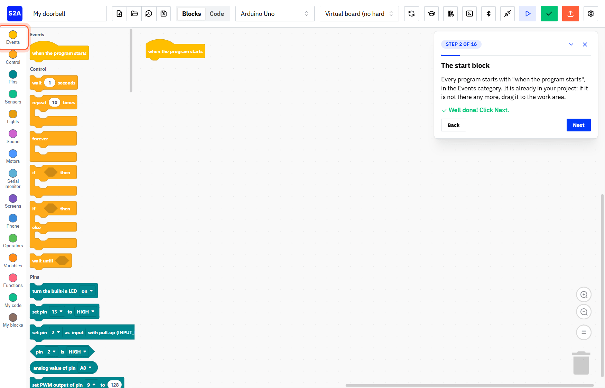

*Pour le lire en français, change la langue dans les paramètres.*

## Contents

1. [Install Scratch2Arduino](#1-install-scratch2arduino)
2. [Plug in the board](#2-plug-in-the-board)
3. [The window](#3-the-window)
4. [Build a program with blocks](#4-build-a-program-with-blocks)
5. [Block categories](#5-block-categories)
6. [Check and upload](#6-check-and-upload)
7. [Live mode](#7-live-mode)
8. [Serial monitor](#8-serial-monitor)
9. [Wiring diagram](#9-wiring-diagram)
10. [Variables, functions and "My blocks"](#10-variables-functions-and-my-blocks)
11. [Write code: "My code"](#11-write-code-my-code)
12. [Projects: save, open, share](#12-projects-save-open-share)
13. [Wireless: Wi-Fi and Bluetooth (ESP32, ESP8266)](#13-wireless-wi-fi-and-bluetooth-esp32-esp8266)
14. [Keyboard shortcuts](#14-keyboard-shortcuts)
15. [Troubleshooting](#15-troubleshooting)

## 1. Install Scratch2Arduino

Everything is downloaded from the project's [*Releases*](https://github.com/Zargith/Scratch2Arduino/releases)
page, in the *Assets* part of the latest version.

### Windows (10 or 11)

1. Download `Scratch2Arduino_installer.exe` and run it.
2. If Windows shows "Windows protected your PC", click *More info* then *Run anyway* (the program is not
   signed yet).
3. Choose the language of the installer (French or English), then the kind of installation: **simple**
   (advised: the usual folder, nothing else to choose) or **advanced** (choose the folder, and the expert
   option to build Scratch2Arduino on the computer). An update suggests the kind chosen last time.
4. The installer copies Scratch2Arduino, ready to use, with shortcuts on the desktop and in the Start menu.
   It takes about a minute and needs no internet (except on an old Windows 10 without Microsoft WebView2,
   which it then installs). The tools for the Uno, Nano and Mega are included: no download at the first
   upload either, handy for a whole classroom on the same Wi-Fi.
5. The tasks page shows, from top to bottom: *More boards*, the optional board packages (Nano Every, Uno R4,
   Raspberry Pi Pico, ESP32, ESP8266) with their size to download and on the disk in a column on the right;
   above the list, the total of the ticked boards and the free room on the disk. Ticked boards are downloaded
   at the end of the installation (Internet needed). When updating, the packages already installed show
   "already installed", greyed. You can also install them later in Scratch2Arduino (see
   [The boards' tools](#the-boards-tools)). Then, in advanced mode only, the expert option to build
   Scratch2Arduino on the computer, and last the desktop icon.
6. The last page has a ticked **Launch Scratch2Arduino** box: click *Finish* and Scratch2Arduino opens.

To uninstall: *Settings > Apps*, Scratch2Arduino, *Uninstall*.

### macOS

1. Download the `.dmg` for your Mac and open it (Apple menu > *About This Mac* tells the chip or processor):
   - Apple chip (M1, M2, M3, M4...): `Scratch2Arduino-<version>-macos-arm64.dmg`;
   - Intel processor: `Scratch2Arduino-<version>-macos-x86_64.dmg`.
2. Drag **Scratch2Arduino** onto the **Applications** folder, then eject the disk.
3. The first time, macOS says the application comes from an "unidentified developer" (it is not signed by
   Apple yet):
   - macOS 15 (Sequoia) and newer: open *System Settings > Privacy & Security*, scroll down to the message
     about Scratch2Arduino and click *Open Anyway*, then confirm;
   - macOS 14 and older: right-click (or Ctrl-click) Scratch2Arduino in Applications, choose *Open*, then
     *Open* in the window that appears.

   This is only needed once. If macOS says the application is "damaged", type in the Terminal:
   `xattr -dr com.apple.quarantine /Applications/Scratch2Arduino.app`
4. Genuine Arduino boards are recognised at once. For a board with a CH340 chip (many cheap Nano and ESP32
   boards), install the maker's driver if the board does not show up in the ports.
5. On a Mac with an Apple chip, the board compilers (made by Arduino for Intel Macs, as for the Arduino IDE)
   need **Rosetta**, an Apple component. If it is missing, Scratch2Arduino says so at start-up and offers an
   **Install Rosetta** button: macOS asks for your password, then downloads it from Apple (Internet needed,
   only once). In the Terminal, it is: `softwareupdate --install-rosetta --agree-to-license`.

To uninstall: drag Scratch2Arduino from Applications to the Bin.

### Linux

**Ubuntu 24.04 or newer, Debian 13, Linux Mint 22**: download `scratch2arduino_<version>_amd64.deb`, then in a
terminal, in the download folder:

```bash
sudo apt install ./scratch2arduino_*_amd64.deb
```

(Double-clicking the file also opens the Software centre, which can install it.)

**Fedora 40 or newer, openSUSE Tumbleweed**: download `scratch2arduino-<version>-1.x86_64.rpm`, then:

```bash
sudo dnf install ./scratch2arduino-*.x86_64.rpm        # Fedora
sudo zypper install ./scratch2arduino-*.x86_64.rpm     # openSUSE
```

Scratch2Arduino appears in the applications menu (Education or Development category). The package also
installs the right to use the boards' USB ports: nothing else to do, not even the `dialout` group. If a
board was already plugged in, unplug it and plug it in again.

To uninstall: `sudo apt remove scratch2arduino` (or `sudo dnf remove scratch2arduino`).

**Other distributions (Arch, Manjaro...) or ARM processors (Raspberry Pi)**: install from the
sources. Download *Source code* (zip or tar.gz), unpack it, then in that folder, in a terminal:
`./Scratch2Arduino_installer.sh` (or `./Scratch2Arduino_installer.sh --user` to install it for yourself only).
The script installs what is missing (apt, dnf, pacman or brew), builds and installs Scratch2Arduino.
In that case, on Linux, to be allowed to send programs to the board, type once
`sudo usermod -aG dialout $USER`, then log out and back in.

### Updates

At start-up, Scratch2Arduino looks in the background for a new version and offers it (*Download and
install*, *What's new* or *Later*: nothing is forced). After *Later*, the *Settings* (gear) still show the
version found, without checking again; you can also check there, or switch this check off.

- Windows: *Download and install* starts the installer of the new version and closes Scratch2Arduino; if
  your project is not saved, a question first offers to save it, ignore the changes or cancel. The button
  turns into a spinner while the installer downloads. If the download fails (proxy, antivirus, filtered
  network), your browser downloads the installer instead: run it once downloaded.
- macOS: *Download* gets the `.dmg` for your Mac in the browser; open it and drag Scratch2Arduino to
  Applications like the first time.
- Linux: *Download* opens the release page: download the new `.deb` or `.rpm` and install it like the
  first time: it replaces the older version, your projects and settings are kept. Installed from the
  sources: the *Settings* give the commands to run.

### The boards' tools

The tools for the Arduino Uno, Nano, Mega, Leonardo and Micro come with Scratch2Arduino. The other boards are **optional
packages**, downloaded only if you want them (Internet needed that time, then never again):

| Package | Boards | To download | On the disk |
|---|---|---|---|
| Arduino megaAVR boards | Arduino Nano Every | about 40 MB | about 290 MB |
| Arduino Uno R4 boards | Arduino Uno R4 Minima, Uno R4 WiFi | about 125 MB | about 730 MB |
| Raspberry Pi Pico boards | Raspberry Pi Pico, Pico W | about 450 MB | about 2.1 GB |
| ESP8266 boards | ESP8266 (NodeMCU) | about 125 MB | about 480 MB |
| ESP32 boards | ESP32 (DevKit) | about 2 GB | about 8 GB |

- In the **Settings** (gear), *More boards* lists them with their size: **Install**, **Update** (a newer
  version for Scratch2Arduino) or **Remove** to free the space (removing asks first).
- In the **Board** list, a board whose package is missing shows "(to install)". Choosing it, opening a project
  made for it, or clicking Check, Upload or Live offers to download its package, with its size. You can say
  *Later*: the board stays chosen, and the **virtual board** already works with it.

Scratch2Arduino keeps its own copy of those tools: it does not change an Arduino IDE installed on the same
computer.

## 2. Plug in the board

1. Plug the board in with a **data** USB cable (some cables only charge: if the board never shows up,
   try another cable).
2. In the top bar, choose the **Board**: Arduino Uno, Nano, Mega 2560, Leonardo, Micro, Nano Every, Uno R4
   Minima or WiFi, Raspberry Pi Pico or Pico W, ESP32 DevKit or ESP8266 NodeMCU (all but the first five first
   need their package, see [The boards' tools](#the-boards-tools)). The **first upload to a new Raspberry Pi
   Pico**: unplug it, hold its **BOOTSEL** button while plugging it back in, release it (it shows up as a USB
   drive), then click Upload; later uploads work without the button. On a Pico the pins are named GP0 to
   GP28 (as printed on the board) and the on-board LED is the pin "LED".
3. Choose the **Port**: the list shows the plugged-in boards. If it is empty, click
   **Look for plugged-in boards** (the circular arrow next to it).

> Always unplug the board before changing wires, and check the circuit before plugging it back in.

## 3. The window

- **Top bar**, from left to right: the project name; *New*, *Open*, *Save*, *Recent projects*; the
  board and the port; *Tutorials and help*; *Serial monitor*; *Wi-Fi* (only for an ESP32 or an ESP8266) and *Bluetooth* (ESP32, or an Arduino board with an HC-05 / HC-06 module);
  *Wiring diagram*; **Live**, **Check**, **Upload**; the **Settings** (the gear: language, light or dark appearance, looking for a new version, the optional board packages, *Report a problem* which opens a GitHub page already filled with your version, system and board). On a small
  screen, Live, Check and Upload only show their icon: hover them to read their name.
- **Palette** (left): the block categories, each with its colour. Click a category to see its blocks.
- **Workspace** (centre): where you put the blocks together. The wheel scrolls; the **+**, **−** and
  **=** buttons (bottom right) zoom; the **trash can** throws away the blocks dropped on it.
- **Panels** (right, when open): the live values of Live mode, the serial monitor.
- **Status bar** (bottom): what is going on ("Checking the program...") and the problems to fix.

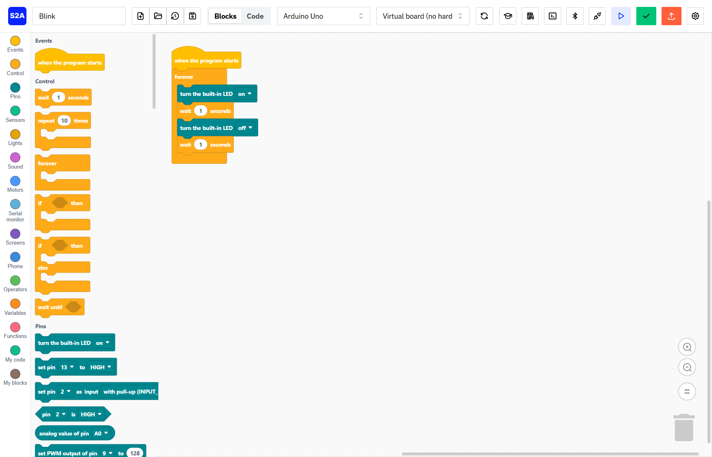

The **Settings** (the gear):

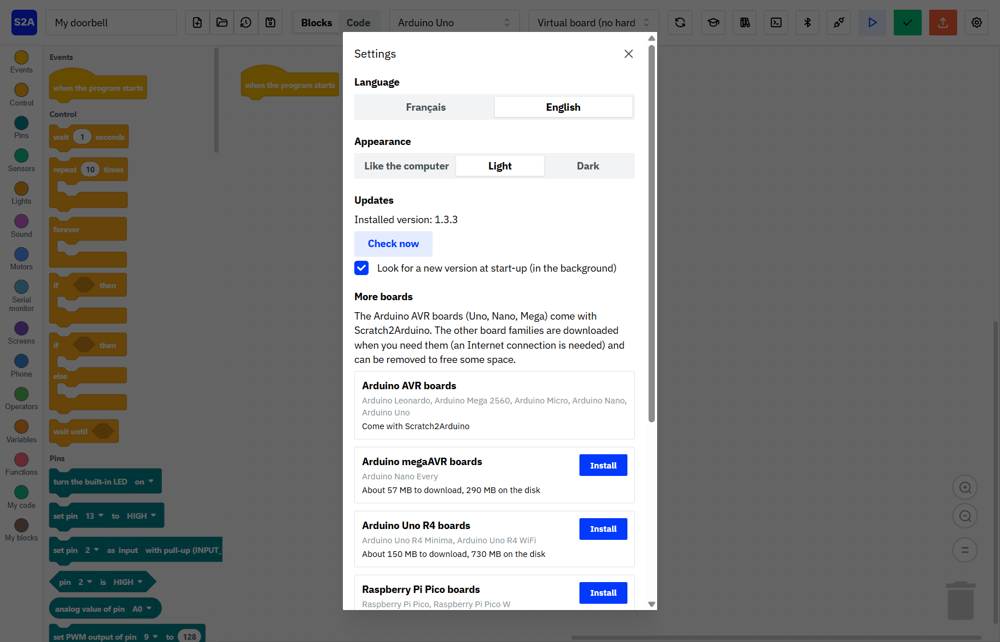

The same window with the **dark** appearance, here in Live mode on the virtual board:

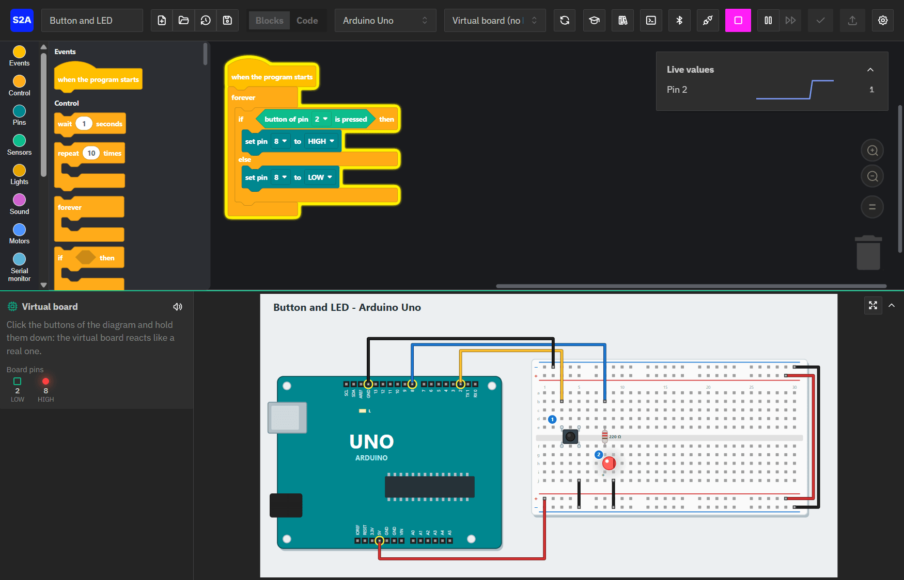

## 4. Build a program with blocks

- **Add a block**: drag it from the palette to the workspace.
- **Attach**: bring a block under another one, or into the "mouth" of a block like *forever*: it snaps
  in when a grey shadow appears.
- **Fill a slot**: click a white slot to type a number or a text; drag a round block (a value) or a
  hexagonal block (a condition, true or false) into the slot that has its shape.
- **Choose from a menu**: click the small arrow (a pin number, *HIGH* / *LOW*, a colour, a note...).
- **Move**: dragging a block also takes every block attached below it.
- **Delete**: drag the block to the palette or the trash can, or select it and press *Delete*.
- **Right-click a block**: duplicate, add a comment, delete, *Save to My blocks*.
- **Undo / redo**: Ctrl+Z / Ctrl+Y (see the [shortcuts](#14-keyboard-shortcuts)).

A program **always** starts with the **when the program starts** block (*Events* category). Blocks that
are not attached to a start block are **greyed out**: they are not sent to the board, like drafts. You
can leave some lying around while you experiment.

While you build, the editor never interrupts you: errors are only looked for when you click **Check**,
**Upload** or **Live**.

## 5. Block categories

| Category | What it is for | Example blocks |
|---|---|---|
| Events | Where the program starts | when the program starts |
| Control | Wait, repeat, choose | wait 1 seconds, repeat 10 times, forever, if ... then ... else, wait until |
| Pins | The board's pins | turn the built-in LED on, set pin 13 to HIGH, pin 2 is HIGH, analog value of pin A0, set PWM output of pin 9 to 128 |
| Sensors | Read the world | button of pin 2 is pressed, position of the potentiometer (0 to 100), light measured, distance in cm (HC-SR04), temperature and humidity (DHT11, DHT22), joystick (position, direction, pressed down), motion seen by a PIR sensor, obstacle in front of an infrared sensor |
| Lights | Coloured LEDs | RGB LED, NeoPixel strip, 8x8 LED matrix (MAX7219) |
| Sound | The buzzer | play 440 Hz for 1 seconds, start / stop the buzzer, note C4 |
| Motors | Make things move | servo (0 to 180°), DC motor through an H-bridge (L298N, L293D), 28BYJ-48 stepper motor (ULN2003 board) turned by an angle |
| Screens | Show text | 16x2 LCD screen (I2C module or 16 pins), SSD1306 OLED screen, TM1637 4-digit display |
| Operators | Compute, compare | + − x /, pick random, map, <, >, =, and, or, not |
| Variables | Remember values | *Make a variable*, set ... to ..., change ... by ... |
| Functions | Reuse a group of blocks | *Make a function*, define ..., call ... |
| Serial monitor | Write to the computer | write ... to the serial monitor |
| Phone (ESP32, or Arduino with an HC-05 / HC-06 module) | Talk to a phone over Bluetooth | HC-05 / HC-06 Bluetooth module, the phone sent ..., number received from the phone, send ... to the phone |
| My blocks | Your saved block groups | see [My blocks](#my-blocks) |

Hover a block of the palette: a tooltip explains what it does and **how to wire the part**. The full
list is in the [block catalog](../block-catalog.md).

## 6. Check and upload

- **Check** looks for problems in the program, then turns it into Arduino code (C++) and compiles it,
  without sending anything. Useful even without a board plugged in.
- **Upload** does the same, then sends the program to the board. It stays there, even unplugged: it
  starts again every time the board is powered (USB, battery or charger).
- The **Code** view (at the top, next to *Blocks*) shows the Arduino code made from your blocks: a good
  way to discover the "real" Arduino language.

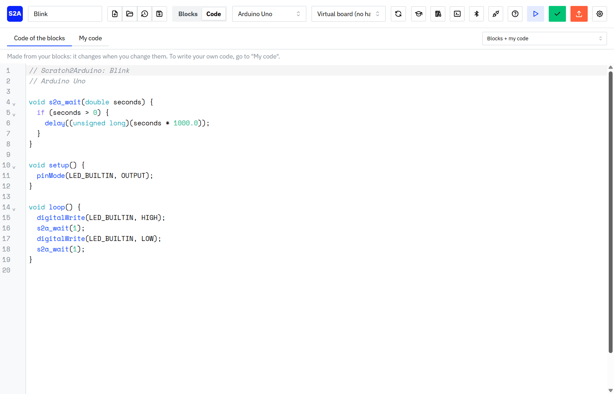

When something is wrong, the status bar explains **what is wrong** and **how to fix it**, and the block
concerned is highlighted in the workspace. For example:

- "Your program does not start anywhere." -> add *when the program starts* and attach your blocks below it;
- "A condition is missing in the "if ... then" block." -> drag a hexagonal block into the empty slot;
- "Pin 7 of the Arduino Uno board cannot do "PWM output"." -> choose one of the pins offered (those marked with
  a `~` on the board).

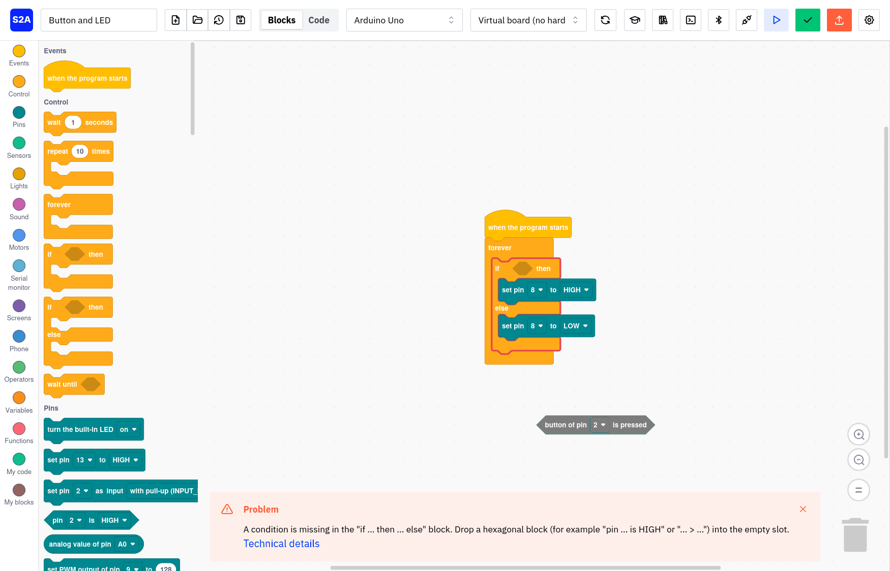

## 7. Live mode

Click **Live**: the blocks run **on the computer**, which drives the board live through the cable. You
see the effect of a change at once, without uploading:

- the running scripts **glow**;
- the right panel shows the **variables** and the **sensors** read by the blocks, with a graph of the
  last 30 seconds;
- change a block (a number, a pin, an added block...): the board follows immediately.

**Program output**: what your program writes (the *write ... to the serial monitor* block, `print()` in
Python or JavaScript) shows in the serial monitor panel, which opens by itself at the first line. To debug,
`printError()` (and `console.error()` in JavaScript) writes in red, on the error output; the error that
stops a program also stays there, with its line, after the stop.

**Wiring check**: when Live mode starts, before your blocks, Scratch2Arduino reads for a second the
buttons and sensors they use. When a value looks wrong, a *Check the wiring* card tells what to look at:
a button always pressed, a pin that "floats" (values changing by themselves: a loose wire or a missing
resistor), a distance sensor without echo, a DHT sensor that does not answer. *Show the blocks* shows the
blocks concerned. These are hints: the program runs anyway. Once fixed, start Live again to check again.

**Step by step**: to understand what your program does, click **Pause** (next to *Stop*, key F9). The
blocks stop and the block about to run is lit. Each click on **Next block** (F10) runs that block only:
watch the board and the variables change, one block at a time. *Wait* blocks no longer make you wait in
step-by-step mode. With several scripts, they take turns. **Resume** (F9) runs the program at normal speed
again. Step by step works for blocks (also with "My code"), not for a whole program written in Python or
JavaScript.

The first time, Scratch2Arduino installs a small program on the board, *S2A live*, which listens to the
computer's orders (a few seconds). Click **Stop** to leave Live mode: the board's outputs are switched
off. For the board to work on its own, without the computer, use **Upload**.

**Without a board: the virtual board**. No board at hand? Choose the **Virtual board (no hardware)**
port, then click **Live** (it is chosen by itself when no board is plugged in). Your blocks run on a
board drawn on the screen: the *Virtual board* panel opens at the bottom of the window, with **the wiring
diagram of your project coming to life** on the right and the settings on the left. The button at the top
right of the diagram enlarges it.

- On the diagram, the **outputs** follow the blocks: LEDs light up (brighter or dimmer with PWM), the RGB
  LED takes its colour, the board's "L" LED follows pin 13, the servo arm and the stepper shaft turn, the
  LCD, OLED and 4-digit screens show their text, the NeoPixel strip and the LED matrix their colours, and
  the buzzer vibrates (with its sound, which the speaker button mutes).
- On the diagram too, **click and hold** a push button, the joystick (to press it down), the PIR motion
  sensor or the obstacle sensor: the board sees it while you hold it.
- On the left, the **settings** for what cannot be handled on a drawing: sliders of a potentiometer, a light
  sensor, the joystick's axes, a distance sensor or a DHT sensor (temperature and humidity); with the
  *Phone* blocks, type the phone's message at the bottom of the settings.

The parts shown are the ones of the wiring diagram, computed from your blocks. The rest of the Live mode
works too: step by step, variables, serial monitor, Python and JavaScript. The virtual board takes no
program: to **Upload**, plug in a real board and choose its port.

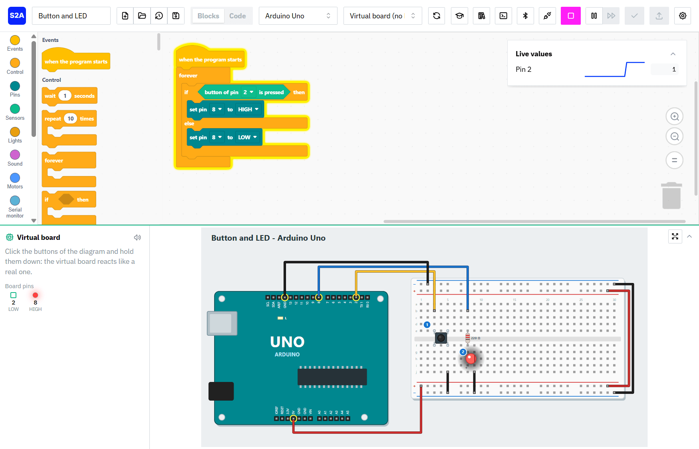

## 8. Serial monitor

The **Serial monitor** button opens a panel showing what the board writes with the block
*write ... to the serial monitor*. Upload your program, then click **Connect** (speed 9600). A line typed at
the bottom is sent to the board. During an upload the monitor pauses, then reconnects. In Live mode the
panel shows what the blocks write.

## 9. Wiring diagram

The **Wiring diagram** button (in the Blocks view as in the Code view) shows how to wire the parts **used
by your blocks**:

- **Wiring diagram**: the board, a breadboard and the parts, with one coloured wire per connection
  (wheel or double-click to zoom, drag to move around, *Save the image* to print it);
- **Components to wire**: the same wiring as a table - each leg of each part, the board pin it goes to
  and what to put in between (for example the 220 Ω resistor of an LED); *Show the blocks* highlights the
  blocks concerned;
- **Example layout** (for an example): the hand-drawn layout.

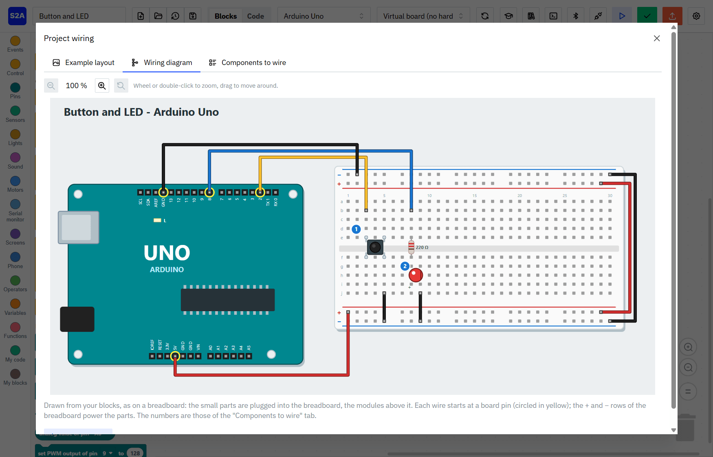

**Program written as code**: in expert mode (whole program in C++, Python or JavaScript) and for "My
code", the diagram is computed from your code. Scratch2Arduino looks for the components in it:
`myServo.attach(9)` is a servo on pin 9, `DHT sensor(4, DHT22)` a DHT22 on pin 4, `pinMode(2,
INPUT_PULLUP)` with `digitalRead(2)` a button, `analogRead(A0)` an analog sensor, `tone(8, ...)` a buzzer,
`pulseIn()` a distance sensor, `digitalWrite` an LED (or other output)... Pins written as numbers or as
constants (`const int led = 13;`, `#define BUTTON 2`) are understood; a pin kept in a variable that changes
is not. The table tells on which line of the code each component was found.

The diagram also warns when a pin is used by two parts, when an I2C screen lost its SDA/SCL pins, or
when the parts need more current than a USB port gives.

Breadboard reminders: the 5 holes of a column (a to e, or f to j) are joined; the **+** (red) and **−**
(blue) rows along the edges are joined along their whole length. Red wire = 5V, black wire = GND.

## 10. Variables, functions and "My blocks"

### Variables

A variable is a box that remembers a value (a score, a distance...). In the *Variables* category, click
**Make a variable** and give it a name. Then use *set ... to ...*, *change ... by ...* and the round block
bearing its name. In Live mode its value shows on the right.

### Functions

A function gives a name to a group of blocks to reuse it (like Scratch's "My Blocks"). In the
*Functions* category, click **Make a function**, attach blocks under **define ...**, then use **call ...** as
many times as you like. A function does not run on its own at start-up, and it cannot call itself.
Right-click *define* to rename or delete it. Example: the [traffic light](tutorials/02-traffic-light.md).

A function can also have **inputs** (up to 4): numbers that each *call* gives it. For instance a
*beep* function with the inputs *times* and *length* can beep 3 times quickly or once for a long time.
In the window of **Make a function** (or right-click *define* -> **Edit the function**), click **Add an
input** and give it a name. The *call* block then has a slot for each input, and the *Functions* category
has a block named after each input: put it inside the function (for instance in "repeat ... times") to use
the number of the call. Outside its function, this block has no number: *Check* tells you.

### My blocks

To keep a group of blocks **for all your projects**: right-click its first block -> **Save to My
blocks** (the blocks attached below are kept too). The group appears in the *My blocks* category: click
it to add it to your project. **Manage my blocks** renames, deletes, **exports** (a `.s2ablocks` file)
and **imports** them on another computer.

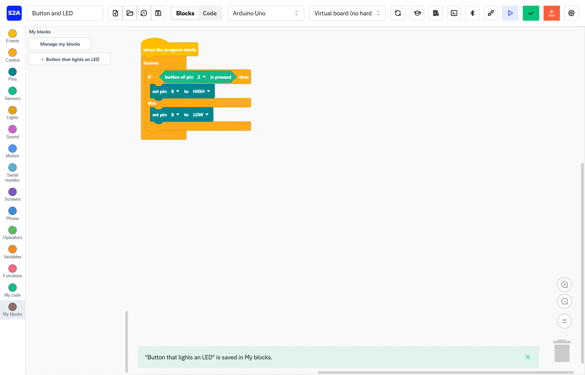

## 11. Write code: "My code"

When blocks are not enough, write your own functions in **C++**, **Python** or **JavaScript** next to the
blocks: they become new blocks.

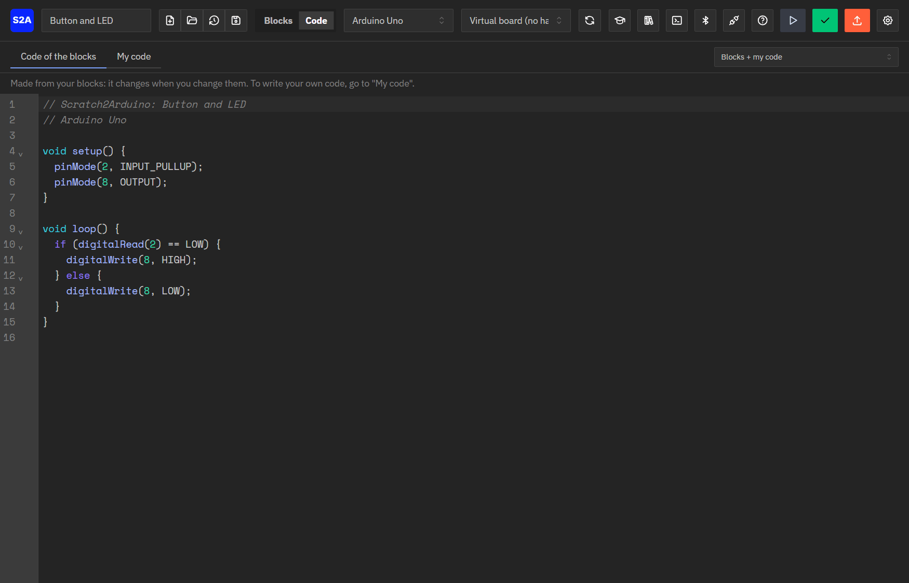

1. At the top, switch the **View** from *Blocks* to **Code**. The **Code of the blocks** tab shows the
   Arduino code made from your blocks (read-only).
2. **My code** tab: choose a language. An example appears (a `speed` variable, `blink` and `average`
   functions): change it or replace it. The editor colours the code and suggests completions (language
   words, Arduino functions, names already written).
3. Go back to the **Blocks** view: the **My code** category holds a block per function (with slots for its
   numbers), a block for a function's result, and blocks to read or change each variable (numbers, and
   `String` texts in C++). A constant, or a variable your code changes itself in one of its functions (its
   state, like `lampe` of a switch), only has a block to read it: a block changing it would disturb your
   code.

- In **C++**, your code is compiled with the blocks: *Check* and *Upload* work as usual.
- In **Python** or **JavaScript**, your code runs on the computer, with the **Live** button (with the
  Arduino functions `digitalWrite`, `analogRead`, `delay`...). *Upload* works too: your code is then
  translated to C++ and compiled with the blocks. If a line cannot be translated, the message gives its
  number.
- Errors in your code show on their line, only when you click *Check*, *Upload* or *Live*. *Delete my
  code* (in the tab) removes it from the project.
- **Change language**: choose another language for "My code" (or for the program in expert mode) and
  your code is **converted**: C++, Python and JavaScript in every direction, even the C++ made from the
  blocks that you did not change (only an empty example is replaced by the one of the new language). Variables, functions,
  if / else, loops and the Arduino functions are translated; what the conversion cannot translate stays as
  comments, and the message tells which lines to finish by hand.
- **Expert mode**: the whole program can also be written as text (*Whole program in C++, Python or
  JavaScript*); *Language help* lists the available functions. In C++, the program starts with "My code",
  then the code of your blocks; in Python or JavaScript, that same code is translated straight into the
  chosen language. Your blocks and "My code" are kept: going back to the blocks finds them,
  and going to expert mode again offers to take back the code you had written.

### Arduino libraries

A **library** adds ready-made functions to your C++ code (read an unusual sensor, decode JSON...).
Blocks install their own by themselves; for your own code, use the **Arduino libraries** button (books
icon, top right):

1. **Search** tab: type a name or a keyword (for example `json`), then *Search*. The first time, the list
   of libraries is downloaded (Internet needed). It is Arduino's official list (Library Manager), the same as
   on [docs.arduino.cc/libraries](https://docs.arduino.cc/libraries/): the link is given under the search.
   Descriptions are in English.
2. *Add to the project* installs the library (its latest version, or the one chosen in the list) and adds
   it to the project.
3. **This project** tab: shows the `#include <...>` line to write at the top of "My code".
   *Remove from the project* takes it off the list.
4. **Installed** tab: everything installed on the computer, with *Update* and *Uninstall*.

The libraries of the project are saved in the `.s2a` file: on another computer, *Check* installs them by
itself. If your code uses a library that is missing, the *Check* message gives its name and suggests
libraries that may contain it.

## 12. Projects: save, open, share

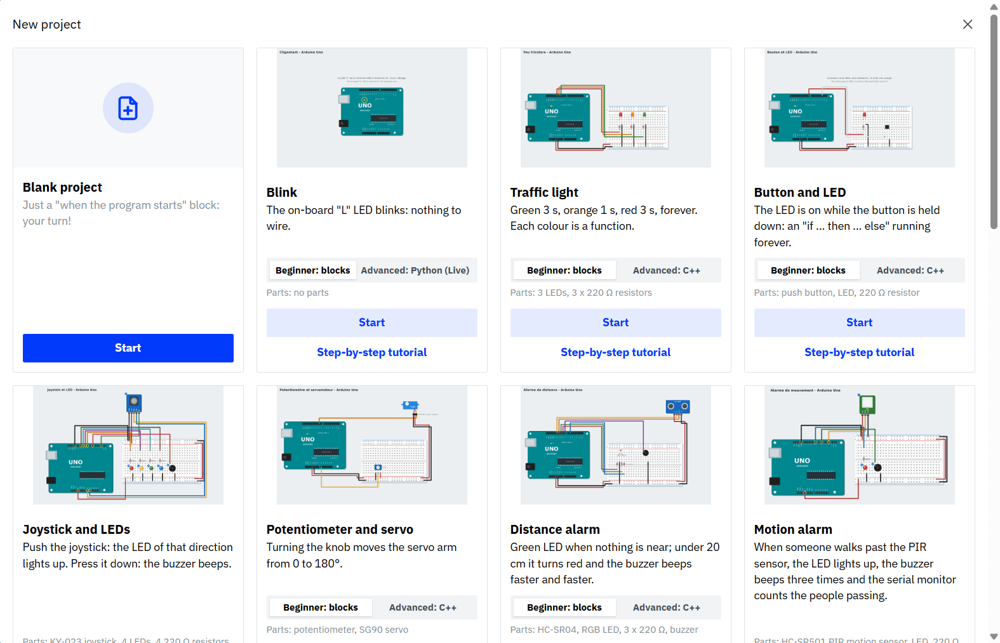

- **New** opens the gallery: a **blank project** or an **example** (with its parts and its diagram).
  Some examples come in several versions, to choose on the card: other parts (I2C or 16-pin screen), or
  another level - **Beginner** (blocks only) or **Advanced** (with "My code"). An opened example is a
  copy: save it to keep your changes.
- **Save** (Ctrl+S) writes a **`.s2a`** file, stored by default in `Documents/Scratch2Arduino`. That file
  holds the whole project: it is what you send to someone, copy to a USB stick or hand in to your teacher.
  It is a zip archive: renamed to `.zip`, it shows `project.json` (the blocks) and the code you typed
  ("My code" in `my_code.cpp`, `.py` or `.js`; a program written as text in `program.cpp`, `.py` or `.js`).
- **Open** reads a `.s2a` back. On Windows, double-clicking a `.s2a` opens it too, and a project can be
  dropped on the Scratch2Arduino icon.
- **Recent projects** (the clock) reopens the latest projects, each with a picture of its blocks or code.
- **Autosave**: every 15 seconds a backup copy is kept. If the application or the computer stops,
  Scratch2Arduino offers to **recover** the project at the next start.

## 13. Wireless: Wi-Fi and Bluetooth (ESP32, ESP8266)

An ESP32 or ESP8266 board can be driven in Live mode **without a cable**:

- **Wi-Fi** (ESP32, ESP8266): start Live mode once over the USB cable. The board then creates its own
  **S2A-xxxx** network (password `scratch2arduino`): connect the computer to it and choose the port
  **Wi-Fi - the board's network**. The **Wi-Fi** button can also make it join the home or school network
  (the computer then keeps its Internet).
- **Bluetooth** (ESP32): start Live mode once over the USB cable, then **Bluetooth** button -> **Look for
  boards** -> choose your "S2A-..." board. On a Mac, first connect "S2A-..." in *System Settings > Bluetooth*.
- **HC-05 / HC-06 Bluetooth module** (Uno, Nano, Mega): an Arduino board has no Bluetooth, but an HC-05
  or HC-06 module gives it one for the Live mode. **Bluetooth** button:
  1. Wire the module: VCC to 5V, GND to GND, **TXD** of the module to the pin that receives (10 by
     default), **RXD** of the module to the pin that sends (11 by default) through a voltage divider
     (1 kΩ between the pin and RXD, 2 kΩ between RXD and GND), as RXD only takes 3.3 V.
  2. With the board plugged in over USB, choose the pins and click **Save on the board**: the Live
     program is installed if needed and the board remembers the pins.
  3. In the computer's Bluetooth settings, pair "HC-05" (or "HC-06") with the code **1234** (or 0000),
     then **Look for boards** -> choose your module. On a Mac, then choose the port "Bluetooth - HC-05"
     in the port list.

  The blocks cannot use the two pins of the module: the Live mode says so and shows the blocks to
  change. Pins 0 and 1 stay for the USB cable. On a Mega, the pin that receives must be 10 to 13, 50 to
  53 or A8 to A15, or use one of its serial ports (19 and 18, 17 and 16, 15 and 14). The module is a
  plain serial link: if the computer goes away, the board does not know it and keeps its outputs; the
  **Stop** button switches them off.
- **Phone with a module** (Uno, Nano, Mega): add the **HC-05 / HC-06 Bluetooth module** block under
  "when the program starts", with the pins where the module is wired (same wiring as above). The
  *Phone* blocks then go through the module, when uploaded and in Live mode over the USB cable. On the
  phone, the app connects to "HC-05" (code 1234 or 0000). Without this block, Check says so.
- **Phone** (ESP32): the *Phone* blocks exchange messages with a Bluetooth terminal app on the phone
  (for example "Serial Bluetooth Terminal" on Android). See the [remote robot](tutorials/08-remote-robot.md).

Programs are always uploaded with the USB cable.

## 14. Keyboard shortcuts

| Shortcut (⌘ instead of Ctrl on a Mac) | Action |
|---|---|
| Ctrl+S | Save the project |
| Ctrl+C / Ctrl+X | Copy / cut the selected block, with the blocks below it |
| Ctrl+V | Paste |
| Ctrl+Z | Undo |
| Ctrl+Y or Ctrl+Shift+Z | Redo |
| Delete or Backspace | Delete the selected block |
| F9 / F10 | Live mode: pause or resume / run the next block |

While typing in a slot (a number, a text, the project name), these keys act on the text instead.

## 15. Troubleshooting

| What happens | What to do |
|---|---|
| The port list is empty | Click *Look for plugged-in boards*. Try another cable (some carry no data) or another USB port. On Linux, check the `dialout` group ([install](#1-install-scratch2arduino)). "Compatible" boards with a CH340 chip sometimes need a driver on Windows and macOS. |
| "This board's tools need Rosetta" (Mac with an Apple chip) | Click *Install Rosetta* in the notice (or type `softwareupdate --install-rosetta --agree-to-license` in the Terminal), then try again. |
| macOS: the port list shows `/dev/cu.debug-console` or `Bluetooth-Incoming-Port` | These ports belong to macOS, not to a board: update to 1.3.2 or newer, which hides them. With no board plugged in, choose *Virtual board*. |
| "The board's port cannot be used" | Another program uses the board: close the Arduino IDE or another serial monitor, then try again. |
| "The board does not answer" | Unplug the board, plug it back in, choose its port again, then try again. Check that the right board is chosen (Uno, Nano...). |
| The first upload is slow | Normal: the board's tools are downloaded once (Internet needed). |
| The program is sent but nothing happens | Open the *Wiring diagram* and compare it with your circuit: an LED the wrong way round (long leg = +), a wire in the wrong breadboard column, a missing GND... |
| An LED does not light | It may be the wrong way round, or without a resistor (it may have burnt out). Try it with the block *set pin ... to HIGH* alone. |
| The buzzer plays only one sound | Use a **passive** buzzer to play notes; an active buzzer only makes one sound. |
| The LCD screen stays blank | Turn the small contrast potentiometer (on the back of the I2C module, or the one wired to V0 for a 16-pin screen). |
| "Oops, the editor stopped" | Click *Start again*: your saved projects are not touched. If it happens again, send the details shown to the developers (see [contributing](../../CONTRIBUTING.md)). |
