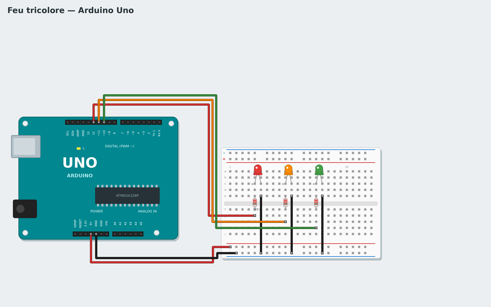

# Tutorial 2 — Traffic light

**Goal**: a traffic light: green 3 seconds, orange 1 second, red 3 seconds, forever.
**Time**: 45 minutes. **Parts**: Uno board, breadboard, 3 LEDs (red, orange, green), 3 × 220 Ω resistors
(red-red-brown), 5 wires.
**You will learn**: wiring an LED, a sequence of actions, functions.

*Français : [../../fr/tutorials/02-traffic-light.md](../../fr/tutorials/02-traffic-light.md)*

## 1. The circuit



Board **unplugged**:

1. Plug the 3 LEDs into the upper half of the breadboard. An LED has a direction: the **long leg** (+)
   goes towards the board pin, the **short leg** (−) towards GND.
2. Each LED has its **220 Ω resistor**, between its long leg and the wire going to the board. Without a
   resistor, the LED gets too much current and burns out.
3. Wire the board's **5V** to the **+** row (red) and **GND** to the **−** row (blue), then each short leg
   to the − row.
4. Wires from the board: red LED → pin **12**, orange → **11**, green → **10**.

> On the breadboard, the 5 holes of a column (a to e, or f to j) are joined together.

## 2. Light one LED

First, check the circuit with a very simple program:

```
when the program starts
set pin 12 to HIGH
```

The **set pin … to …** block is in the **Pins** category. Choose pin **12** in its menu. **HIGH** = 5 volts
on the pin: the LED lights up. **LOW** = 0 volts: it goes off. Click **Live**: the red LED lights up. Try
pins 11 and 10. If an LED stays off, turn it round.

## 3. The light sequence

Build the full cycle inside a **forever**:

```
when the program starts
forever
    set pin 12 to LOW
    set pin 11 to LOW
    set pin 10 to HIGH
    wait 3 seconds
    set pin 12 to LOW
    set pin 11 to HIGH
    set pin 10 to LOW
    wait 1 seconds
    set pin 12 to HIGH
    set pin 11 to LOW
    set pin 10 to LOW
    wait 3 seconds
```

Tip: **right-click → Duplicate** a block to copy it with the blocks below it. Try it in **Live**, then
**Upload**.

## 4. Tidy up with functions

The program is long and the three colours are hard to see. A **function** gives a name to a group of
blocks:

1. **Functions** category → **Make a function** → name it `green light`.
2. A **define green light** block appears: attach below it the three blocks that light the green.
3. Do the same for `orange light` and `red light`.
4. The main program becomes:

```
when the program starts
forever
    call green light
    wait 3 seconds
    call orange light
    wait 1 seconds
    call red light
    wait 3 seconds
```

The program reads like a sentence! A function only runs when it is **called**.
To compare, open the example: **New → Traffic light** (its functions have French names: *feu vert*, *feu orange*, *feu rouge*).

## Advanced version: with code

Choose **Advanced: C++** in the gallery: one C++ function, `feux(rouge, orange, vert)`, written in **My code**, switches the lights given (1 = on, 0 = off); `clignoterOrange(fois)` blinks the orange. In the blocks they are two blocks of the **My code** category, with slots for their numbers. C++ is compiled with the blocks: **Upload** as usual.

## Challenges

- Add a blinking orange (3 times) before the red, with **repeat 3 times**.
- Make a pedestrian light: a 4th green LED (pin 9) lit only while the car light is red.
- Make an `all off` function and call it at the start of the program.

## If it does not work

- Only one LED stays off: turn it round (long leg towards the resistor).
- No LED lights up: check the GND wire and the − row of the breadboard.
- Open **Wiring diagram**: it draws the circuit matching **your** blocks.

**Next**: [Tutorial 3 — Button and LED](03-button-led.md)
