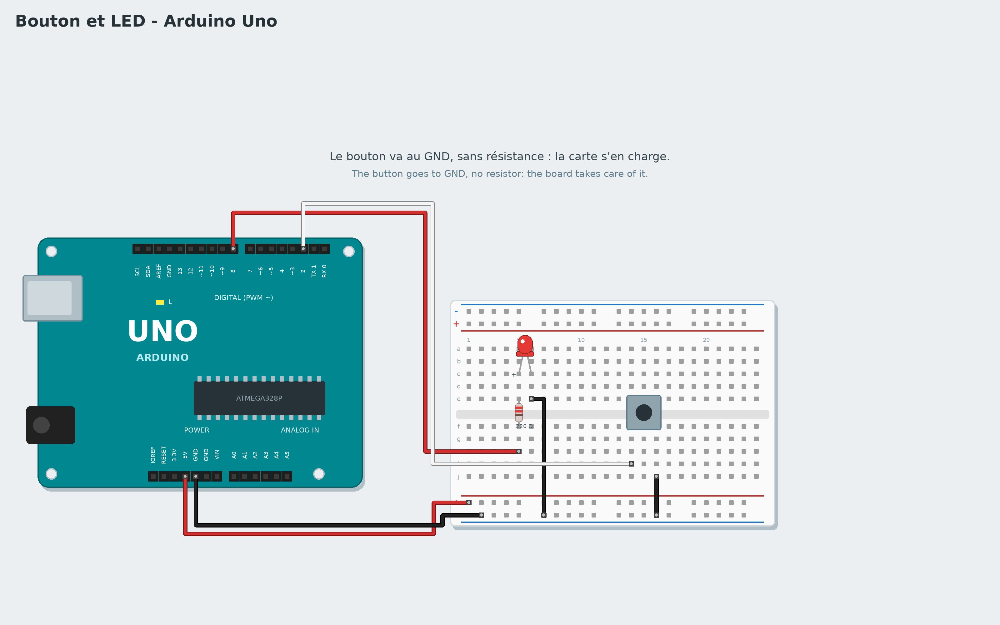

# Tutorial 3 — Button and LED

**Goal**: the LED is on while the button is held down.
**Time**: 40 minutes. **Parts**: Uno board, breadboard, a push button, an LED, a 220 Ω resistor, 5 wires.
**You will learn**: reading an input, conditions ("if … then … else"), a loop that keeps watching.

*Français : [../../fr/tutorials/03-button-led.md](../../fr/tutorials/03-button-led.md)*

## 1. The circuit



Board **unplugged**:

1. The LED and its 220 Ω resistor, as in tutorial 2: long leg → resistor → pin **8**; short leg → − row.
2. The button **across the groove** in the middle of the breadboard. One side of the button goes to pin
   **2**, the other side to **GND**. No resistor: the board has one built in, which the button block
   switches on by itself.

## 2. A condition

The **if … then … else** block (**Control** category) chooses between two paths. Its hexagonal slot
expects a **condition**: something true or false. The **button of pin 2 is pressed** block (**Sensors**
category) is true while the button is pressed, false otherwise.

```
when the program starts
forever
    if button of pin 2 is pressed then
        set pin 8 to HIGH
    else
        set pin 8 to LOW
```

1. Drag **forever** under the start block.
2. Drag **if … then … else** into it.
3. Drag **button of pin 2 is pressed** into the hexagonal slot.
4. Into *then*: **set pin 8 to HIGH**. Into *else*: the same with **LOW**.

> **Why "forever"?** The board must watch the button **all the time**. Without the loop it would look at
> it once, at start-up, then never again.

Click **Check**: if the condition is missing, Scratch2Arduino tells you. Start **Live** and press: the LED
lights up. Look on the right: the button's value changes live. Then **Upload**.

## 3. A switch

What about a button that switches on at the first press and off at the second? The program must
**remember** whether the lamp is on: that is what a **variable** is for.

1. **Variables** category → **Make a variable** → `lamp`.
2. Program:

```
when the program starts
set lamp to 0
forever
    wait until button of pin 2 is pressed
    if lamp = 0 then
        set lamp to 1
        set pin 8 to HIGH
    else
        set lamp to 0
        set pin 8 to LOW
    wait until not button of pin 2 is pressed
```

The last block waits for the button to be **released**: otherwise, while the finger presses, the lamp
would change hundreds of times a second. The **=** and **not** blocks are in the **Operators** category.

## Challenges

- The other way round: the LED is on, and goes off while the button is pressed.
- Add a buzzer on pin 7 that beeps while the button is pressed (**Sound** category).
- Count the presses in a variable and write it to the **serial monitor**.

## If it does not work

- The LED is always on: the button may be turned a quarter turn. Its legs are joined two by two: put it
  across the groove, as on the diagram.
- The LED never lights up: check that the other side of the button goes to GND.

**Next**: [Tutorial 4 — Potentiometer and servo](04-servo-potentiometer.md)
