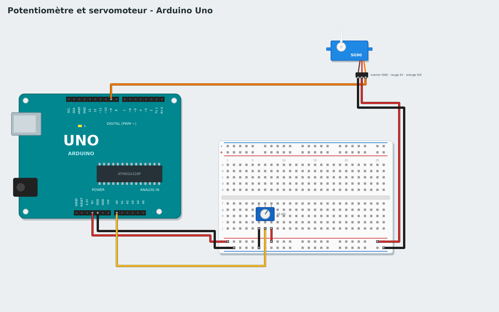

# Tutorial 4 - Potentiometer and servo

**Goal**: turning a knob (potentiometer) turns the arm of a servo motor.
**Time**: 45 minutes. **Parts**: Uno board, breadboard, 10 kΩ potentiometer, SG90 servo, wires.
**You will learn**: an analog input (a value, not just yes/no), variables, mapping a range of values.

*Pour le lire en français, change la langue dans les paramètres.*

## 1. The circuit



Board **unplugged**:

1. **Potentiometer**: one outer leg to **5V**, the other to **GND**, the **middle** leg to pin **A0**.
2. **Servo**: brown wire -> GND, red wire -> 5V, orange wire (signal) -> pin **9**.

## 2. Read the potentiometer

The button was only *pressed* or *not pressed*. A potentiometer gives a **value**: the block **position
of the potentiometer of pin A0 (0 to 100)** (**Sensors** category) gives 0 turned fully one way, 100
fully the other way.

```
when the program starts
forever
    write position of the potentiometer of pin A0 (0 to 100) to the serial monitor
    wait 0.2 seconds
```

Start **Live** and turn the knob: the value shows on the right with a **graph**.

## 3. Drive the servo

A servo goes to the angle it is given, from **0 to 180 degrees**. But the potentiometer gives 0 to 100:
the value must be **mapped**. The **map ... from 0 - 100 to 0 - 180** block (**Operators** category) does
the rule of three: 50 becomes 90, 100 becomes 180.

1. Make a variable `angle` (**Variables** category).
2. Program:

```
when the program starts
forever
    set angle to map (position of the potentiometer of pin A0) from 0 - 100 to 0 - 180
    turn the servo of pin 9 to angle degrees
    wait 0.05 seconds
```

The **angle** block (the variable) is in the **Variables** category: drag it into the servo's slot. Try it
in **Live**: the value of `angle` shows on the right. Then **Upload**.

> **Why a variable?** It keeps the computed value and gives it a name: the program is easier to read,
> and you can follow its value live.

## Advanced version: with code

Choose **Advanced: C++** in the gallery: the `angleLisse()` function of **My code** "smooths" the reading (it only goes a fifth of the way towards each new reading) and maps it to an angle. The arm no longer jitters. Try replacing `/ 5` with `/ 20`: what happens?

## Challenges

- Keep the arm between 45 and 135 degrees.
- Replace the servo with an LED on pin 9 and the block **set PWM output of pin 9 to ...** (0 to 255): you
  get a light dimmer.
- With a light sensor (photoresistor), make a needle showing the light in the room.

## If it does not work

- The servo jitters: add **wait 0.05 seconds**, and check that GND is shared.
- The value goes from 100 to 0 instead of 0 to 100: swap the two outer legs of the potentiometer.
- The board restarts when the servo moves: it draws too much current; use a USB port of the computer
  (not a hub), or a separate power supply for the servo.

**Next**: [Tutorial 5 - Distance alarm](05-distance-alarm.md)
