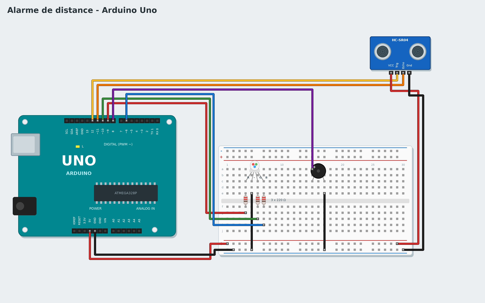

# Tutorial 5 - Distance alarm

**Goal**: a green LED when nothing is near; under 20 cm it turns red and a buzzer beeps, faster and
faster as you get closer.
**Time**: 1 hour. **Parts**: Uno board, breadboard, HC-SR04 ultrasonic sensor, RGB LED (common cathode),
3 x 220 Ω resistors, buzzer, wires.
**You will learn**: measuring a distance, comparing with a threshold, using a value to set a duration.

*Pour le lire en français, change la langue dans les paramètres.*

## 1. The circuit



| Part | Wiring |
|---|---|
| HC-SR04 | VCC -> 5V, Trig -> **12**, Echo -> **11**, Gnd -> GND |
| RGB LED | R -> **9**, G -> **10**, B -> **6**, each through a 220 Ω resistor; longest leg (−) -> GND |
| Buzzer | + -> **8**, − -> GND |

The sensor sends an ultrasonic "shout" (too high-pitched for our ears) and measures how long the echo
takes to come back, like a bat.

## 2. Measure

1. Make a variable `distance`.
2. Test program:

```
when the program starts
forever
    set distance to distance in cm from the ultrasonic sensor (Trig 12, Echo 11)
    wait 0.1 seconds
```

Start **Live**: the distance shows on the right, with its graph. Move your hand closer.

## 3. The alarm

The distance is compared with a **threshold**: 20 cm. The **... < ...** block is in **Operators**.

```
when the program starts
forever
    set distance to distance in cm from the ultrasonic sensor (Trig 12, Echo 11)
    if distance < 20 then
        set the RGB LED (R 9, G 10, B 6) to red
        play 880 Hz for 0.1 seconds on the buzzer of pin 8
        wait distance / 100 seconds
    else
        set the RGB LED (R 9, G 10, B 6) to green
        wait 0.1 seconds
```

The trick: **wait distance / 100 seconds**. At 20 cm the pause lasts 0.2 s; at 5 cm, 0.05 s: the closer
you are, the closer the beeps, like a car's parking sensor.

Try it in **Live** (change the threshold while it runs!), then **Upload**.

## Advanced version: with code

Choose **Advanced: C++** in the gallery: **My code** holds `moyenne()`, which ignores impossible readings and averages the latest ones (the sensor is sometimes wrong), and `pauseEntreBips()`, which computes the beep rhythm. The blocks stay short and read like a sentence.

## Challenges

- Add an orange zone between 20 and 40 cm (an **if ... then ... else** inside the *else*).
- Play a higher note when very close.
- Make a "ruler": write the distance to the serial monitor.

## If it does not work

- The distance is always 0: Trig and Echo may be swapped.
- The LED shows the wrong colour: check the leg order (R, −, G, B); the longest is the −.

**Next**: [Tutorial 6 - Thermometer](06-thermometer.md)
