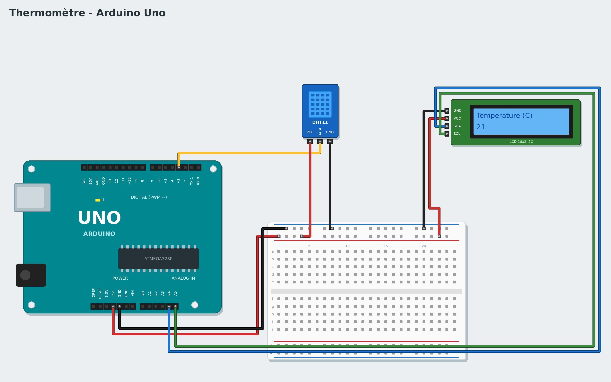

# Tutorial 6 — Thermometer

**Goal**: a screen shows the temperature, then the air humidity, every 2 seconds.
**Time**: 1 hour. **Parts**: Uno board, DHT11 sensor, 16×2 LCD screen with an I2C module (4 pins), wires.
(Variant: 16-pin LCD screen + 10 kΩ potentiometer + 220 Ω resistor.)
**You will learn**: a digital sensor, a screen, showing text and numbers.

*Français : [../../fr/tutorials/06-thermometer.md](../../fr/tutorials/06-thermometer.md)*

## 1. The circuit



| Part | Wiring |
|---|---|
| DHT11 | VCC → 5V, DATA → **3**, GND → GND |
| I2C LCD screen | GND → GND, VCC → 5V, SDA → **A4**, SCL → **A5** |

The I2C screen needs only 2 data wires: SDA and SCL. On a Mega they are pins 20 and 21.

You have a **16-pin** screen without an I2C module? In the gallery (**New**), choose the *Thermometer*
example, then the **16-pin screen** version: its diagram shows the 12 wires to connect.

## 2. Write on the screen

```
when the program starts
write Hello! on line 1 of the I2C LCD screen
```

The block is in the **Screens** category. The screen has 2 lines of 16 characters. Accents cannot be
shown (the screen does not know them): Scratch2Arduino removes them.

**Upload**: if the screen stays blank or all blue, turn the small blue potentiometer on the back of the
module (the **contrast**).

## 3. The thermometer

```
when the program starts
forever
    write Temperature (C) on line 1 of the I2C LCD screen
    write temperature in °C from the DHT11 sensor of pin 3 on line 2 of the I2C LCD screen
    wait 2 seconds
    write Humidity (%) on line 1 of the I2C LCD screen
    write air humidity (0 to 100) from the DHT11 sensor of pin 3 on line 2 of the I2C LCD screen
    wait 2 seconds
```

The round **temperature** and **humidity** blocks are in **Sensors**: drag them into the text slot. Choose
**DHT11** (blue) or **DHT22** (white) to match your sensor. Breathe on the sensor: the humidity rises!

> A DHT11 cannot be read more than once a second: the **wait 2 seconds** blocks matter.

## Challenges

- Show "It is hot!" above 25 °C (**if … then** + **… > …**).
- Remember the highest temperature in a `record` variable and show it.
- Add a blue LED that lights up when it is cold.

## If it does not work

- The screen shows boxes on line 1: the program did not get there; check SDA and SCL.
- The temperature is 0 or never changes: check the DATA pin (3) and the sensor type chosen.

**Next**: [Tutorial 7 — Reaction game](07-reaction-game.md)
