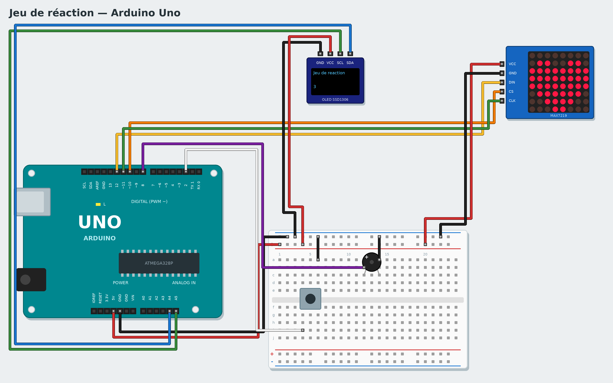

# Tutorial 7 — Reaction game

**Goal**: a game! Wait for the heart to appear on the LED matrix, then press as fast as you can.
Pressing too early loses. The score shows on a small screen.
**Time**: 1 h 30. **Parts**: Uno board, MAX7219 8×8 LED matrix, SSD1306 OLED screen (I2C), push button,
passive buzzer, breadboard, wires.
**You will learn**: randomness, waiting for an event, keeping a score, a complete project.

*Français : [../../fr/tutorials/07-reaction-game.md](../../fr/tutorials/07-reaction-game.md)*

## 1. The circuit



| Part | Wiring |
|---|---|
| MAX7219 matrix | VCC → 5V, GND → GND, DIN → **12**, CS → **10**, CLK → **11** |
| OLED screen | VCC → 5V, GND → GND, SDA → **A4**, SCL → **A5** |
| Button | one side → **2**, the other → GND |
| Buzzer | + → **8**, − → GND |

## 2. The pieces of the game

Try each block alone before putting everything together (in **Live**, it is instant):

- **show heart on the LED matrix (DIN 12, CLK 11, CS 10)** (**Lights** category): choose the picture in
  the menu (heart, sad, check mark, all off…).
- **write … on line 1 of the OLED screen** (**Screens** category).
- **pick random 1 to 4** (**Operators** category): a different number every time.
- **wait until …** (**Control** category): the program stops until the condition is true.

## 3. The game

Make a variable `score`, then:

```
when the program starts
set score to 0
write Reaction game on line 1 of the OLED screen
write score on line 3 of the OLED screen
forever
    wait until not button of pin 2 is pressed
    show all off on the LED matrix
    wait pick random 1 to 4 seconds
    if button of pin 2 is pressed then
        show sad on the LED matrix
        play 150 Hz for 0.5 seconds on the buzzer of pin 8
    else
        show heart on the LED matrix
        play note C5 Hz for 0.1 seconds on the buzzer of pin 8
        wait until button of pin 2 is pressed
        show check mark on the LED matrix
        change score by 1
        write score on line 3 of the OLED screen
    wait 1 seconds
```

Read it like a story: wait for the player to let go of the button, switch off, wait a **random** time (so
nobody can guess). If the button is already pressed at that moment, the player cheated: sad face.
Otherwise the heart appears, we wait for the press, and a point is won.

To save time, open the example: **New → Reaction game**.

## Challenges

- The player loses a point when pressing too early (**change score by -1**).
- Measure the reaction time: count hundredths of a second while waiting for the press (a **repeat** loop
  with **wait 0.01 seconds** and **change time by 1**) and show it.
- Two-player game: a second button on pin 3, the fastest wins.

## If it does not work

- The matrix stays lit or shows nonsense: check DIN, CLK and CS, and the 5V.
- The buzzer hums all the time: it is an active buzzer; use a **passive** one.
- The OLED screen stays black: check SDA (A4) and SCL (A5).

**Next**: [Tutorial 8 — Remote robot](08-remote-robot.md)
