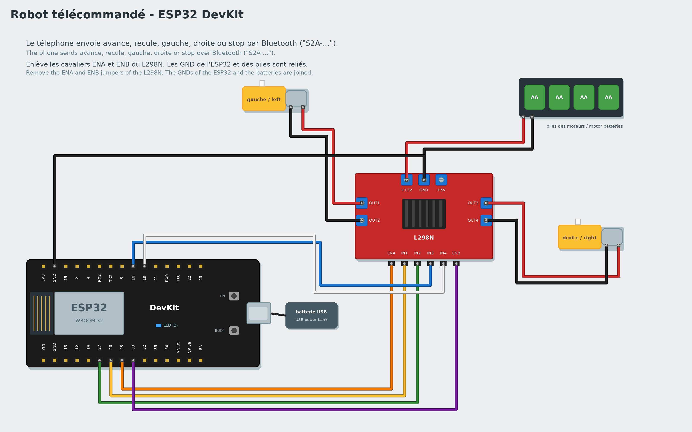

# Tutorial 8 — Remote robot

**Goal**: a two-wheeled robot driven from a phone over Bluetooth.
**Time**: 2 hours. **Parts**: ESP32 DevKit board, L298N H-bridge, 2 (yellow) gear motors with their
wheels, a chassis (or a cardboard box), a 4 × AA battery holder, a USB power bank, an Android phone with
the "Serial Bluetooth Terminal" app, wires.
**You will learn**: motors, wireless communication, organising a big program with functions.

*Français : [../../fr/tutorials/08-remote-robot.md](../../fr/tutorials/08-remote-robot.md)*

## 1. The circuit



A board pin cannot give enough current for a motor: the **L298N H-bridge** sits in between. The board
tells it which way and how fast to turn; it takes the energy from the batteries.

| L298N | Wiring |
|---|---|
| OUT1, OUT2 | **left** motor |
| OUT3, OUT4 | **right** motor |
| +12V, GND (terminal) | batteries: + to +12V, − to GND |
| GND (terminal) | also to the **ESP32's GND** (required: otherwise the orders do not get through) |
| ENA, IN1, IN2 | ESP32 **25**, **26**, **27** (left motor) |
| ENB, IN3, IN4 | ESP32 **33**, **18**, **19** (right motor) |

**Remove the jumpers** (small caps) on ENA and ENB: the board sets the speed. The ESP32 runs on a USB
power bank.

## 2. Turn one motor

Plug the ESP32 into the computer, choose the **ESP32 (DevKit)** board, then:

```
when the program starts
run the motor (EN 25, IN1 26, IN2 27) forward at speed 80
wait 2 seconds
stop the motor (EN 25, IN1 26, IN2 27)
```

The blocks are in the **Motors** category. The speed goes from 0 to 100. If the wheel turns the wrong
way, swap its two wires on OUT1/OUT2. Do the same with the right motor (EN 33, IN1 18, IN2 19).

## 3. The moves, as functions

Make 5 functions (**Functions** category):

| Function | Left motor | Right motor |
|---|---|---|
| forward | forward, 80 | forward, 80 |
| backward | backward, 80 | backward, 80 |
| turn left | backward, 60 | forward, 60 |
| turn right | forward, 60 | backward, 60 |
| stop | stop | stop |

To turn on the spot, one wheel goes forward while the other goes backward.

## 4. The remote control

The blocks of the **Phone** category talk to a phone over Bluetooth: **the phone sent avance** is true
**once** when the message "avance" arrives (capital letters and accents do not matter). The example uses
French words (`avance`, `recule`, `gauche`, `droite`, `stop`): use any words you like.

```
when the program starts
call stop
forever
    if the phone sent avance then
        call forward
        send ok : avance to the phone
    if the phone sent recule then
        call backward
        send ok : recule to the phone
    (the same for gauche, droite and stop)
```

Or open the complete example: **New → Remote robot** (its functions have French names: *avancer*, *reculer*, *tourner à gauche*, *tourner à droite*, *arrêter*).

1. **Upload** (with the USB cable), then unplug the cable and plug in the USB power bank.
2. On the phone: switch Bluetooth on, open **Serial Bluetooth Terminal**, menu **Devices → Bluetooth
   Classic**, choose **S2A-…** (no code), then connect.
3. Type `avance` and send it: the robot moves forward and answers "ok : avance". Tip: a long press on the
   app's **M1** to **M5** buttons stores the 5 words, to drive with one finger.

> Live mode over Bluetooth is not possible with the Phone blocks: the board has a single Bluetooth
> connection, taken by the phone. Test in Live mode over the USB cable instead (typing the words on the
> phone), or upload.

## Advanced version: with code

Choose **Advanced: C++** in the gallery: one function, `rouler(gauche, droite)`, sets the speed of each wheel from -100 (backward) to 100 (forward). It replaces the five functions: `rouler(80, 80)` goes forward, `rouler(-60, 60)` turns left. Invent gentler turns, like `rouler(80, 40)`.

## Challenges

- Add a word `vite` (fast) that sets the speed to 100, and `lent` (slow) to 50 (a `speed` variable).
- The robot stops by itself 1 second after each order: true "step by step" driving.
- Add an ultrasonic sensor at the front: the robot refuses to go forward closer than 15 cm to an obstacle.

## If it does not work

- The phone does not find "S2A-…": check that the program is uploaded and the ESP32 is powered; iPhones
  have no such Bluetooth app: use Android.
- The motors do not turn but the board answers: flat batteries, ENA/ENB jumpers still on, or battery GND
  not joined to the ESP32.
- Only one wheel turns: check IN3, IN4 and ENB.

Well done, you have finished the progression! To go further, combine what you have learnt: a robot that
avoids obstacles, a wireless weather station (**New → Wireless weather station**)…
