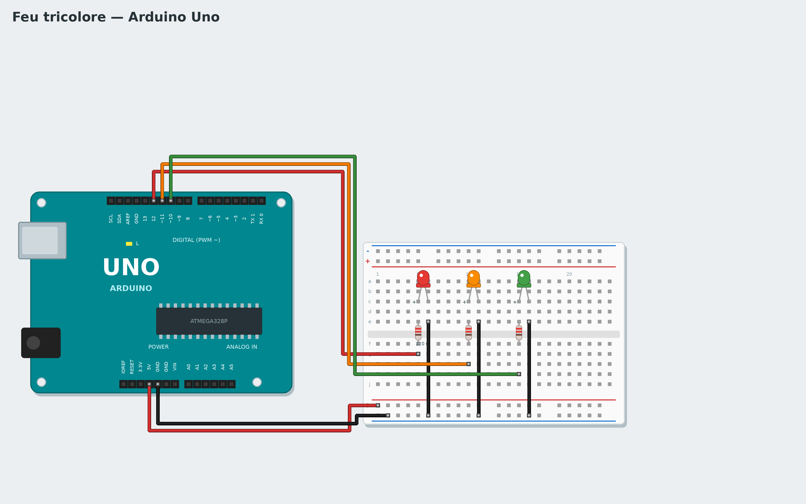

# Tutoriel 2 — Feu tricolore

**Objectif** : un feu de circulation : vert 3 secondes, orange 1 seconde, rouge 3 secondes, sans fin.
**Durée** : 45 minutes. **Matériel** : carte Uno, platine d'essai, 3 LED (rouge, orange, verte),
3 résistances de 220 Ω (rouge-rouge-marron), 5 fils.
**Tu vas apprendre** : brancher une LED, une séquence d'actions, les fonctions.

*English: [../../en/tutorials/02-traffic-light.md](../../en/tutorials/02-traffic-light.md)*

## 1. Le montage



Carte **débranchée** :

1. Plante les 3 LED dans la moitié haute de la platine. Une LED a un sens : la **patte longue** (+) va
   vers la broche de la carte, la **patte courte** (−) vers le GND.
2. Chaque LED a sa **résistance de 220 Ω**, entre sa patte longue et le fil qui va à la carte. Sans
   résistance, la LED reçoit trop de courant et grille.
3. Relie le **5V** de la carte à la rangée **+** (rouge) et le **GND** à la rangée **−** (bleue), puis
   chaque patte courte à la rangée −.
4. Fils de la carte : LED rouge → broche **12**, orange → **11**, verte → **10**.

> Dans la platine, les 5 trous d'une même colonne (a à e, ou f à j) sont reliés entre eux.

## 2. Allume une LED

Avant tout, vérifie le montage avec un programme tout simple :

```
quand le programme démarre
mettre la broche 12 à l'état HAUT
```

Le bloc **mettre la broche … à l'état …** est dans la famille **Broches**. Choisis la broche **12** dans
son menu. **HAUT** = 5 volts sur la broche : la LED s'allume. **BAS** = 0 volt : elle s'éteint. Clique sur
**Live** : la LED rouge s'allume. Essaie les broches 11 et 10. Si une LED reste éteinte, retourne-la.

## 3. La séquence du feu

Construis le cycle complet dans un **répéter indéfiniment** :

```
quand le programme démarre
répéter indéfiniment
    mettre la broche 12 à l'état BAS
    mettre la broche 11 à l'état BAS
    mettre la broche 10 à l'état HAUT
    attendre 3 secondes
    mettre la broche 12 à l'état BAS
    mettre la broche 11 à l'état HAUT
    mettre la broche 10 à l'état BAS
    attendre 1 secondes
    mettre la broche 12 à l'état HAUT
    mettre la broche 11 à l'état BAS
    mettre la broche 10 à l'état BAS
    attendre 3 secondes
```

Astuce : fais un **clic droit → Dupliquer** sur un bloc pour le copier avec ceux qui sont en dessous.
Essaie en **Live**, puis **Téléverse**.

## 4. Range avec des fonctions

Le programme est long et on ne voit pas bien les trois couleurs. Une **fonction** donne un nom à un
groupe de blocs :

1. Famille **Fonctions** → **Créer une fonction** → nomme-la `feu vert`.
2. Un bloc **définir feu vert** apparaît : accroche dessous les trois blocs qui allument le vert.
3. Fais pareil pour `feu orange` et `feu rouge`.
4. Le programme principal devient :

```
quand le programme démarre
répéter indéfiniment
    appeler feu vert
    attendre 3 secondes
    appeler feu orange
    attendre 1 secondes
    appeler feu rouge
    attendre 3 secondes
```

Le programme se lit comme une phrase ! Une fonction ne s'exécute que quand on l'**appelle**.
Pour comparer, ouvre l'exemple : **Nouveau → Feu tricolore**.

## Version avancée : avec du code

Choisis **Avancé : C++** dans la galerie : une seule fonction C++, `feux(rouge, orange, vert)`, écrite dans **Mon code**, allume les feux demandés (1 = allumé, 0 = éteint) ; `clignoterOrange(fois)` fait clignoter l'orange. Dans les blocs, ce sont deux blocs de la famille **Mon code**, avec des cases pour leurs nombres. Le C++ est compilé avec les blocs : **Téléverse** comme d'habitude.

## Défis

- Ajoute un orange clignotant (3 fois) avant le rouge, avec **répéter 3 fois**.
- Fais un feu piéton : une 4ᵉ LED verte (broche 9) allumée seulement quand le feu des voitures est rouge.
- Crée une fonction `tout éteindre` et appelle-la au début du programme.

## Si ça ne marche pas

- Une seule LED ne s'allume pas : retourne-la (patte longue vers la résistance).
- Aucune LED ne s'allume : vérifie le fil GND et la rangée − de la platine.
- Ouvre **Schéma de câblage** : il dessine le montage correspondant à **tes** blocs.

**Suivant** : [Tutoriel 3 — Bouton et LED](03-button-led.md)
