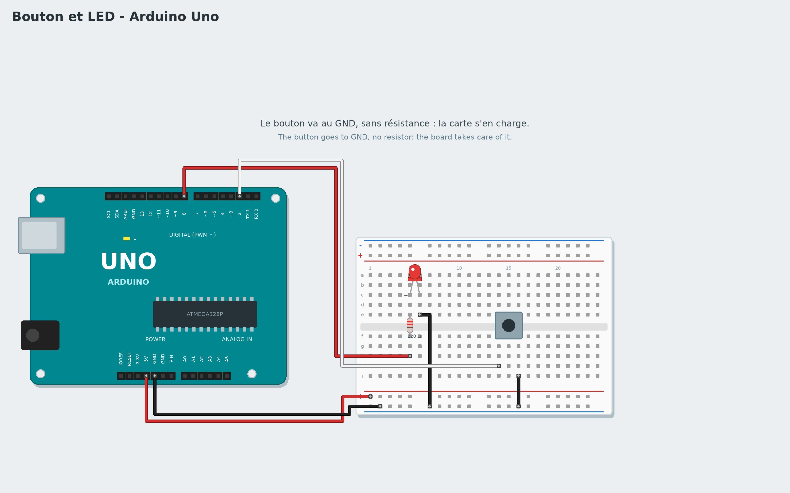

# Tutoriel 3 - Bouton et LED

**Objectif** : la LED s'allume tant qu'on appuie sur le bouton.
**Durée** : 40 minutes. **Matériel** : carte Uno, platine d'essai, un bouton-poussoir, une LED,
une résistance de 220 Ω, 5 fils.
**Tu vas apprendre** : lire une entrée, les conditions ("si ... alors ... sinon"), une boucle qui surveille.

*To read it in English, change the language in the settings.*

## 1. Le montage



Carte **débranchée** :

1. La LED et sa résistance de 220 Ω, comme au tutoriel 2 : patte longue -> résistance -> broche **8** ;
   patte courte -> rangée −.
2. Le bouton **à cheval sur la rainure** du milieu de la platine. Un côté du bouton va à la broche **2**,
   l'autre côté au **GND**. Pas de résistance : la carte en a une, intégrée, que le bloc du bouton allume
   tout seul.

## 2. Une condition

Le bloc **si ... alors ... sinon** (famille **Contrôle**) choisit entre deux chemins. La case hexagonale
attend une **condition** : quelque chose de vrai ou faux. Le bloc **le bouton de la broche 2 est
appuyé** (famille **Capteurs**) est vrai quand on appuie, faux sinon.

```
quand le programme démarre
répéter indéfiniment
    si le bouton de la broche 2 est appuyé alors
        mettre la broche 8 à l'état HAUT
    sinon
        mettre la broche 8 à l'état BAS
```

1. Glisse **répéter indéfiniment** sous le bloc de départ.
2. Glisse **si ... alors ... sinon** dedans.
3. Glisse **le bouton de la broche 2 est appuyé** dans la case hexagonale.
4. Dans *alors* : **mettre la broche 8 à l'état HAUT**. Dans *sinon* : la même chose avec **BAS**.

> **Pourquoi "répéter indéfiniment" ?** La carte doit regarder le bouton **sans arrêt**. Sans la
> boucle, elle le regarderait une seule fois, au démarrage, puis plus jamais.

Clique sur **Vérifier** : si la condition manque, Scratch2Arduino te le dit. Lance **Live**, appuie : la
LED s'allume. Regarde à droite : la valeur du bouton change en direct. Puis **Téléverse**.

## 3. Un interrupteur

Et pour un bouton qui allume au premier appui et éteint au second ? Il faut **retenir** si la lampe est
allumée : c'est le rôle d'une **variable**.

1. Famille **Variables** -> **Créer une variable** -> `lampe`.
2. Programme :

```
quand le programme démarre
mettre lampe à 0
répéter indéfiniment
    attendre jusqu'à ce que le bouton de la broche 2 est appuyé
    si lampe = 0 alors
        mettre lampe à 1
        mettre la broche 8 à l'état HAUT
    sinon
        mettre lampe à 0
        mettre la broche 8 à l'état BAS
    attendre jusqu'à ce que non le bouton de la broche 2 est appuyé
```

Le dernier bloc attend qu'on **relâche** le bouton : sinon, tant que le doigt appuie, la lampe changerait
des centaines de fois par seconde. Les blocs **=** et **non** sont dans la famille **Opérateurs**.

## Version avancée : avec du code

Choisis **Avancé : C++** dans la galerie : la fonction `surveillerBouton()` de **Mon code** fait du bouton un vrai interrupteur, sans attendre qu'on le relâche : elle compare l'état du bouton avec celui de la fois d'avant, et ignore les "rebonds" du contact. La variable `lampe` du code est lue par un bloc **lampe** de la famille **Mon code**.

## Défis

- Inverse : la LED est allumée, et s'éteint quand on appuie.
- Ajoute un buzzer sur la broche 7 qui bipe quand on appuie (famille **Son**).
- Compte les appuis dans une variable et écris-la sur le **moniteur série**.

## Si ça ne marche pas

- La LED reste toujours allumée : le bouton est peut-être tourné d'un quart de tour. Ses pattes sont
  reliées deux à deux : place-le bien à cheval sur la rainure, comme sur le schéma.
- La LED ne s'allume jamais : vérifie que l'autre côté du bouton va bien au GND.

**Suivant** : [Tutoriel 4 - Potentiomètre et servomoteur](04-servo-potentiometer.md)
