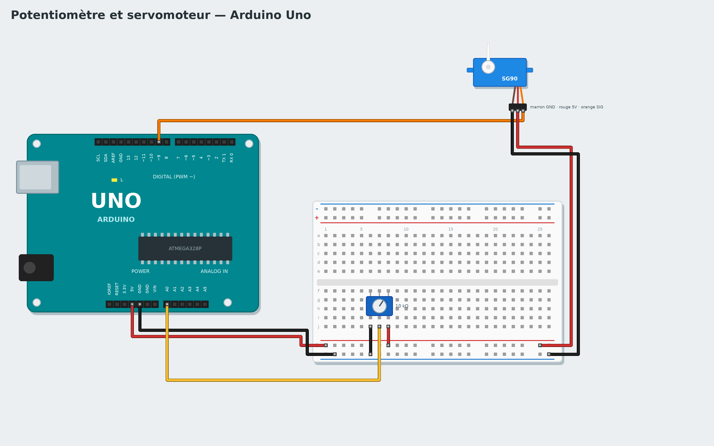

# Tutoriel 4 — Potentiomètre et servomoteur

**Objectif** : tourner un bouton (potentiomètre) fait tourner le bras d'un servomoteur.
**Durée** : 45 minutes. **Matériel** : carte Uno, platine d'essai, potentiomètre 10 kΩ, servomoteur SG90,
fils.
**Tu vas apprendre** : une entrée analogique (une valeur, pas juste oui/non), les variables, convertir
une plage de valeurs.

*English: [../../en/tutorials/04-servo-potentiometer.md](../../en/tutorials/04-servo-potentiometer.md)*

## 1. Le montage



Carte **débranchée** :

1. **Potentiomètre** : une patte du bord au **5V**, l'autre au **GND**, la patte du **milieu** à la
   broche **A0**.
2. **Servomoteur** : fil marron → GND, fil rouge → 5V, fil orange (signal) → broche **9**.

## 2. Lis le potentiomètre

Le bouton n'était que *appuyé* ou *pas appuyé*. Un potentiomètre donne une **valeur** : le bloc
**position du potentiomètre de la broche A0 (0 à 100)** (famille **Capteurs**) donne 0 tourné à fond
d'un côté, 100 à fond de l'autre.

```
quand le programme démarre
répéter indéfiniment
    écrire position du potentiomètre de la broche A0 (0 à 100) sur le moniteur série
    attendre 0.2 secondes
```

Lance **Live** et tourne le bouton : la valeur s'affiche à droite avec un **graphique**.

## 3. Commande le servomoteur

Un servomoteur va à l'angle qu'on lui donne, de **0 à 180 degrés**. Mais le potentiomètre donne 0 à 100 :
il faut **convertir**. Le bloc **convertir … de 0 – 100 vers 0 – 180** (famille **Opérateurs**) fait la
règle de trois : 50 devient 90, 100 devient 180.

1. Crée une variable `angle` (famille **Variables**).
2. Programme :

```
quand le programme démarre
répéter indéfiniment
    mettre angle à convertir (position du potentiomètre de la broche A0) de 0 – 100 vers 0 – 180
    tourner le servomoteur de la broche 9 à angle degrés
    attendre 0.05 secondes
```

Le bloc **angle** (la variable) se trouve dans la famille **Variables** : glisse-le dans la case du
servomoteur. Essaie en **Live** : la valeur de `angle` s'affiche à droite. Puis **Téléverse**.

> **Pourquoi une variable ?** Elle retient la valeur calculée et lui donne un nom : le programme est plus
> facile à lire, et tu peux suivre sa valeur en direct.

## Version avancée : avec du code

Choisis **Avancé : C++** dans la galerie : la fonction `angleLisse()` de **Mon code** « lisse » la mesure (elle ne fait qu'un cinquième du chemin vers chaque nouvelle mesure) et la convertit en angle. Le bras ne tremble plus. Essaie de remplacer `/ 5` par `/ 20` : que se passe-t-il ?

## Défis

- Limite le bras entre 45 et 135 degrés.
- Remplace le servomoteur par une LED sur la broche 9 et le bloc **mettre la sortie PWM de la broche 9
  à …** (0 à 255) : tu obtiens un variateur de lumière.
- Avec un capteur de lumière (photorésistance), fais une aiguille qui montre la lumière de la pièce.

## Si ça ne marche pas

- Le servomoteur tremble : ajoute **attendre 0.05 secondes**, et vérifie que le GND est commun.
- La valeur va de 100 à 0 au lieu de 0 à 100 : inverse les deux pattes du bord du potentiomètre.
- La carte redémarre quand le servo bouge : il tire trop de courant ; utilise un port USB de
  l'ordinateur (pas un hub), ou une alimentation séparée pour le servo.

**Suivant** : [Tutoriel 5 — Alarme de distance](05-distance-alarm.md)
