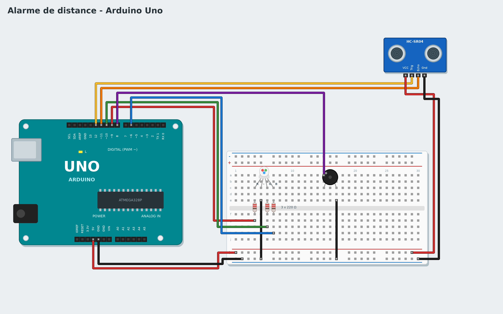

# Tutoriel 5 - Alarme de distance

**Objectif** : une LED verte quand rien n'est proche ; à moins de 20 cm, elle devient rouge et un buzzer
bipe, de plus en plus vite quand on s'approche.
**Durée** : 1 heure. **Matériel** : carte Uno, platine d'essai, capteur à ultrasons HC-SR04, LED RGB
(cathode commune), 3 résistances de 220 Ω, buzzer, fils.
**Tu vas apprendre** : mesurer une distance, comparer à un seuil, utiliser une valeur pour régler une
durée.

*To read it in English, change the language in the settings.*

## 1. Le montage



| Composant | Branchement |
|---|---|
| HC-SR04 | VCC -> 5V, Trig -> **12**, Echo -> **11**, Gnd -> GND |
| LED RGB | R -> **9**, V -> **10**, B -> **6**, chacune par une résistance de 220 Ω ; patte la plus longue (−) -> GND |
| Buzzer | + -> **8**, − -> GND |

Le capteur envoie un "cri" d'ultrasons (trop aigu pour nos oreilles) et mesure le temps que met l'écho
pour revenir, comme une chauve-souris.

## 2. Mesure

1. Crée une variable `distance`.
2. Programme de test :

```
quand le programme démarre
répéter indéfiniment
    mettre distance à distance en cm du capteur à ultrasons (Trig 12, Echo 11)
    attendre 0.1 secondes
```

Lance **Live** : la distance s'affiche à droite, avec son graphique. Approche ta main.

## 3. L'alarme

On compare la distance à un **seuil** : 20 cm. Le bloc **... < ...** est dans **Opérateurs**.

```
quand le programme démarre
répéter indéfiniment
    mettre distance à distance en cm du capteur à ultrasons (Trig 12, Echo 11)
    si distance < 20 alors
        mettre la LED RGB (R 9, V 10, B 6) en rouge
        jouer 880 Hz pendant 0.1 secondes sur le buzzer de la broche 8
        attendre distance / 100 secondes
    sinon
        mettre la LED RGB (R 9, V 10, B 6) en vert
        attendre 0.1 secondes
```

L'astuce : **attendre distance / 100 secondes**. À 20 cm, la pause dure 0,2 s ; à 5 cm, 0,05 s : plus on
est proche, plus les bips sont rapprochés, comme le radar de recul d'une voiture.

Essaie en **Live** (change le seuil pendant que ça tourne !), puis **Téléverse**.

## Version avancée : avec du code

Choisis **Avancé : C++** dans la galerie : **Mon code** contient `moyenne()`, qui ignore les mesures impossibles et fait la moyenne des dernières (le capteur se trompe parfois), et `pauseEntreBips()`, qui calcule le rythme des bips. Les blocs restent courts et se lisent comme une phrase.

## Défis

- Ajoute une zone orange entre 20 et 40 cm (un **si ... alors ... sinon** dans le *sinon*).
- Joue une note plus aiguë quand on est très proche.
- Fais un "mètre" : écris la distance sur le moniteur série.

## Si ça ne marche pas

- La distance vaut toujours 0 : Trig et Echo sont peut-être inversés.
- La LED a une mauvaise couleur : vérifie l'ordre des pattes (R, −, V, B) ; la plus longue est le −.

**Suivant** : [Tutoriel 6 - Thermomètre](06-thermometer.md)
