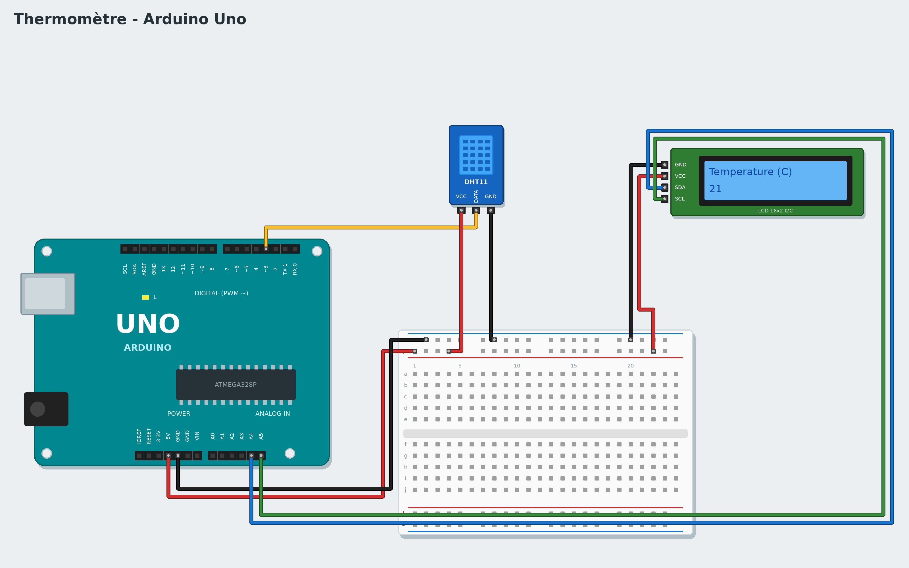

# Tutoriel 6 - Thermomètre

**Objectif** : un écran affiche la température, puis l'humidité de l'air, toutes les 2 secondes.
**Durée** : 1 heure. **Matériel** : carte Uno, capteur DHT11, écran LCD 16x2 avec module I2C (4 broches),
fils. (Variante : écran LCD à 16 broches + potentiomètre 10 kΩ + résistance 220 Ω.)
**Tu vas apprendre** : un capteur numérique, un écran, afficher du texte et des nombres.

*To read it in English, change the language in the settings.*

## 1. Le montage



| Composant | Branchement |
|---|---|
| DHT11 | VCC -> 5V, DATA -> **3**, GND -> GND |
| Écran LCD I2C | GND -> GND, VCC -> 5V, SDA -> **A4**, SCL -> **A5** |

L'écran I2C n'a besoin que de 2 fils de données : SDA et SCL. Sur une Mega, ce sont les broches 20 et 21.

Tu as un écran à **16 broches** sans module I2C ? Dans la galerie (**Nouveau**), choisis l'exemple
*Thermomètre* puis la version **Écran 16 broches** : son schéma montre les 12 fils à brancher.

## 2. Écris sur l'écran

```
quand le programme démarre
écrire Bonjour ! sur la ligne 1 de l'écran LCD I2C
```

Le bloc est dans la famille **Écrans**. L'écran a 2 lignes de 16 caractères. Les accents ne s'affichent
pas (l'écran ne les connaît pas) : Scratch2Arduino les enlève.

**Téléverse** : si l'écran reste vide ou tout bleu, tourne le petit potentiomètre bleu à l'arrière du
module (le **contraste**).

## 3. Le thermomètre

```
quand le programme démarre
répéter indéfiniment
    écrire Température (C) sur la ligne 1 de l'écran LCD I2C
    écrire température en °C du capteur DHT11 de la broche 3 sur la ligne 2 de l'écran LCD I2C
    attendre 2 secondes
    écrire Humidité (%) sur la ligne 1 de l'écran LCD I2C
    écrire humidité de l'air (0 à 100) du capteur DHT11 de la broche 3 sur la ligne 2 de l'écran LCD I2C
    attendre 2 secondes
```

Les blocs ronds **température** et **humidité** sont dans **Capteurs** : glisse-les dans la case du
texte. Choisis **DHT11** (bleu) ou **DHT22** (blanc) selon ton capteur. Souffle sur le capteur :
l'humidité monte !

> Le DHT11 ne peut pas être lu plus d'une fois par seconde : les **attendre 2 secondes** sont utiles.

## Version avancée : avec du code

Choisis **Avancé : C++ (écran I2C)** dans la galerie : **Mon code** convertit la température en degrés Fahrenheit (`fahrenheit()`) et dit si l'air est agréable (`confort()`, entre 19 et 24 °C et entre 40 et 60 % d'humidité). Change les limites selon ta pièce.

## Défis

- Affiche "Il fait chaud !" au-dessus de 25 °C (**si ... alors** + **... > ...**).
- Retiens la température la plus haute dans une variable `record` et affiche-la.
- Ajoute une LED bleue qui s'allume quand il fait froid.

## Si ça ne marche pas

- L'écran affiche des carrés sur la 1ʳᵉ ligne : le programme n'est pas arrivé ; vérifie SDA et SCL.
- La température vaut 0 ou ne change jamais : vérifie la broche DATA (3) et le type de capteur choisi.

**Suivant** : [Tutoriel 7 - Jeu de réaction](07-reaction-game.md)
