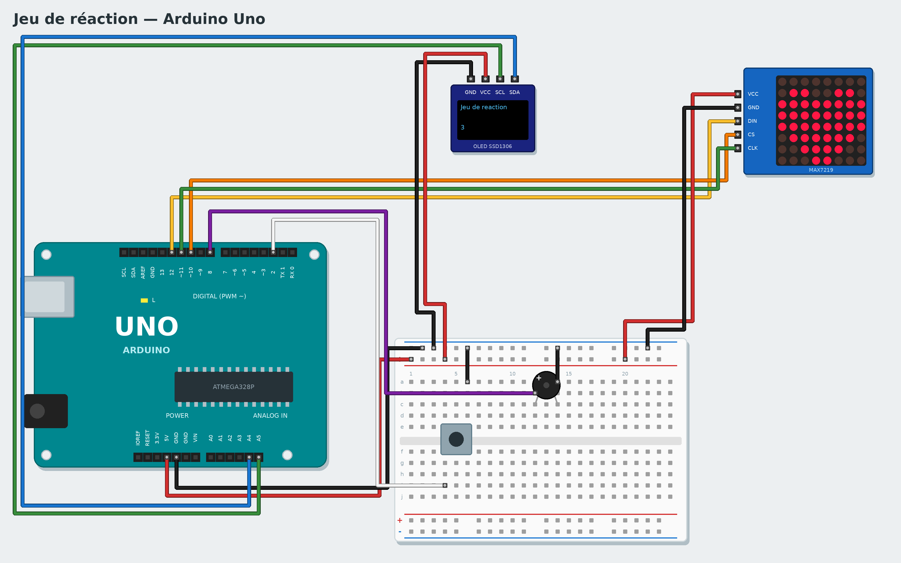

# Tutoriel 7 — Jeu de réaction

**Objectif** : un jeu ! Attends que le cœur apparaisse sur la matrice de LED, puis appuie le plus vite
possible. Appuyer trop tôt, c'est perdu. Le score s'affiche sur un petit écran.
**Durée** : 1 h 30. **Matériel** : carte Uno, matrice de LED 8×8 MAX7219, écran OLED SSD1306 (I2C),
bouton-poussoir, buzzer passif, platine d'essai, fils.
**Tu vas apprendre** : le hasard, attendre un événement, compter un score, un projet complet.

*English: [../../en/tutorials/07-reaction-game.md](../../en/tutorials/07-reaction-game.md)*

## 1. Le montage



| Composant | Branchement |
|---|---|
| Matrice MAX7219 | VCC → 5V, GND → GND, DIN → **12**, CS → **10**, CLK → **11** |
| Écran OLED | VCC → 5V, GND → GND, SDA → **A4**, SCL → **A5** |
| Bouton | un côté → **2**, l'autre → GND |
| Buzzer | + → **8**, − → GND |

## 2. Les morceaux du jeu

Essaie chaque bloc seul avant de tout assembler (en **Live**, c'est immédiat) :

- **afficher cœur sur la matrice de LED (DIN 12, CLK 11, CS 10)** (famille **Lumières**) : choisis le
  dessin dans le menu (cœur, triste, coche, tout éteint…).
- **écrire … sur la ligne 1 de l'écran OLED** (famille **Écrans**).
- **nombre aléatoire entre 1 et 4** (famille **Opérateurs**) : un nombre différent à chaque fois.
- **attendre jusqu'à ce que …** (famille **Contrôle**) : le programme s'arrête jusqu'à ce que la
  condition soit vraie.

## 3. Le jeu

Crée une variable `score`, puis :

```
quand le programme démarre
mettre score à 0
écrire Jeu de réaction sur la ligne 1 de l'écran OLED
écrire score sur la ligne 3 de l'écran OLED
répéter indéfiniment
    attendre jusqu'à ce que non le bouton de la broche 2 est appuyé
    afficher tout éteint sur la matrice de LED
    attendre nombre aléatoire entre 1 et 4 secondes
    si le bouton de la broche 2 est appuyé alors
        afficher triste sur la matrice de LED
        jouer 150 Hz pendant 0.5 secondes sur le buzzer de la broche 8
    sinon
        afficher cœur sur la matrice de LED
        jouer note do 5 Hz pendant 0.1 secondes sur le buzzer de la broche 8
        attendre jusqu'à ce que le bouton de la broche 2 est appuyé
        afficher coche sur la matrice de LED
        ajouter 1 à score
        écrire score sur la ligne 3 de l'écran OLED
    attendre 1 secondes
```

Lis-le comme une histoire : on attend que le joueur lâche le bouton, on éteint, on attend un temps **au
hasard** (pour qu'on ne puisse pas deviner). Si le bouton est déjà appuyé à ce moment-là, le joueur a
triché : visage triste. Sinon le cœur apparaît, on attend l'appui, et on gagne un point.

Pour gagner du temps, tu peux ouvrir l'exemple : **Nouveau → Jeu de réaction**.

## Défis

- Le joueur perd un point quand il appuie trop tôt (**ajouter -1 à score**).
- Mesure le temps de réaction : compte les centièmes de seconde pendant l'attente de l'appui
  (une boucle **répéter** avec **attendre 0.01 secondes** et **ajouter 1 à temps**) et affiche-le.
- Jeu à deux : un second bouton sur la broche 3, le plus rapide gagne.

## Si ça ne marche pas

- La matrice reste allumée ou affiche n'importe quoi : vérifie DIN, CLK et CS, et le 5V.
- Le buzzer bourdonne en permanence : c'est un buzzer actif ; prends un buzzer **passif**.
- L'écran OLED reste noir : vérifie SDA (A4) et SCL (A5).

**Suivant** : [Tutoriel 8 — Robot télécommandé](08-remote-robot.md)
