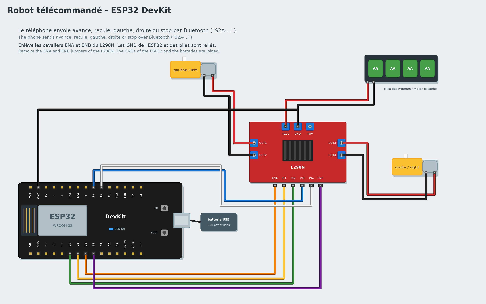
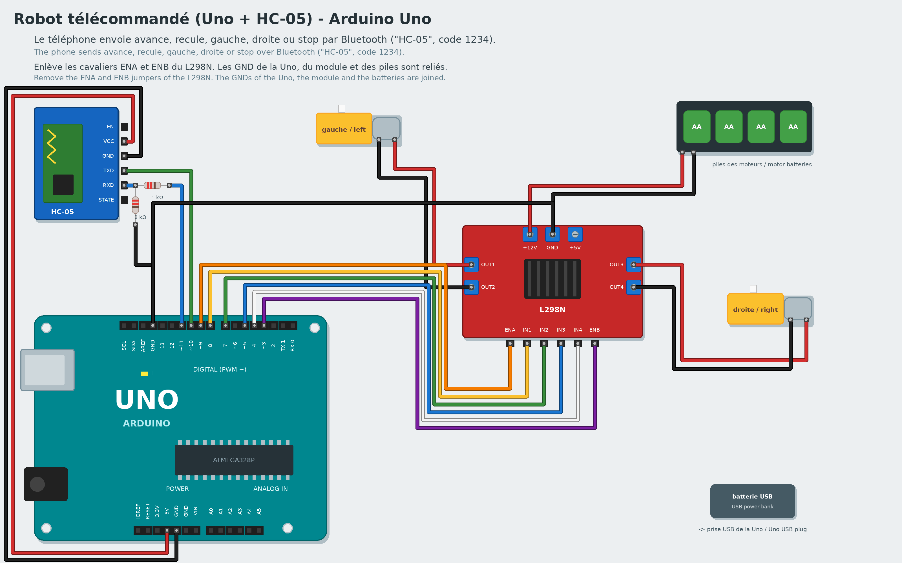

# Tutoriel 8 - Robot télécommandé

**Objectif** : un robot à deux roues piloté depuis un téléphone par Bluetooth.
**Durée** : 2 heures. **Matériel** : carte ESP32 DevKit, pont en H L298N, 2 moteurs à réducteur (jaunes)
avec leurs roues, un châssis (ou une boîte en carton), un boîtier de 4 piles AA, une batterie USB, un
téléphone Android avec l'appli "Serial Bluetooth Terminal", fils.
**Tu vas apprendre** : les moteurs, la communication sans fil, organiser un gros programme avec des
fonctions.

*To read it in English, change the language in the settings.*

## 1. Le montage



Une broche de carte ne donne pas assez de courant pour un moteur : le **pont en H L298N** sert
d'intermédiaire. La carte lui dit dans quel sens et à quelle vitesse tourner ; lui prend l'énergie dans
les piles.

| L298N | Branchement |
|---|---|
| OUT1, OUT2 | moteur de **gauche** |
| OUT3, OUT4 | moteur de **droite** |
| +12V, GND (bornier) | piles : + au +12V, − au GND |
| GND (bornier) | aussi au **GND de l'ESP32** (obligatoire : sinon les ordres n'arrivent pas) |
| ENA, IN1, IN2 | ESP32 **25**, **26**, **27** (moteur de gauche) |
| ENB, IN3, IN4 | ESP32 **33**, **18**, **19** (moteur de droite) |

**Enlève les cavaliers** (petits capuchons) posés sur ENA et ENB : c'est la carte qui règle la vitesse.
L'ESP32 est alimentée par une batterie USB.

## 2. Fais tourner un moteur

Branche l'ESP32 à l'ordinateur, choisis la carte **ESP32 (DevKit)**, puis :

```
quand le programme démarre
faire tourner le moteur (EN 25, IN1 26, IN2 27) en avant à la vitesse 80
attendre 2 secondes
arrêter le moteur (EN 25, IN1 26, IN2 27)
```

Les blocs sont dans la famille **Moteurs**. La vitesse va de 0 à 100. Si la roue tourne à l'envers,
inverse ses deux fils sur OUT1/OUT2. Fais pareil avec le moteur de droite (EN 33, IN1 18, IN2 19).

## 3. Les mouvements, en fonctions

Crée 5 fonctions (famille **Fonctions**) :

| Fonction | Moteur gauche | Moteur droit |
|---|---|---|
| avancer | en avant, 80 | en avant, 80 |
| reculer | en arrière, 80 | en arrière, 80 |
| tourner à gauche | en arrière, 60 | en avant, 60 |
| tourner à droite | en avant, 60 | en arrière, 60 |
| arrêter | arrêter | arrêter |

Pour tourner sur place, une roue avance pendant que l'autre recule.

## 4. La télécommande

Les blocs de la famille **Téléphone** parlent à un téléphone par Bluetooth :
**le téléphone a envoyé avance** est vrai **une fois** quand le message "avance" arrive (les majuscules
et les accents ne comptent pas).

```
quand le programme démarre
appeler arrêter
répéter indéfiniment
    si le téléphone a envoyé avance alors
        appeler avancer
        envoyer ok : avance au téléphone
    si le téléphone a envoyé recule alors
        appeler reculer
        envoyer ok : recule au téléphone
    (pareil pour gauche, droite et stop)
```

Ou ouvre l'exemple complet : **Nouveau -> Robot télécommandé**.

1. **Téléverse** (avec le câble USB), puis débranche le câble et branche la batterie USB.
2. Sur le téléphone : active le Bluetooth, ouvre **Serial Bluetooth Terminal**, menu **Devices ->
   Bluetooth Classic**, choisis **S2A-...** (pas de code), puis connecte-toi.
3. Tape `avance` et envoie : le robot avance et répond "ok : avance". Astuce : un appui long sur les
   boutons **M1** à **M5** de l'appli permet d'y ranger les 5 mots pour piloter d'un doigt.

> Le mode Live par Bluetooth n'est pas possible avec les blocs Téléphone : la carte n'a qu'une seule
> connexion Bluetooth, prise par le téléphone. Teste plutôt en Live par le câble USB (en tapant les mots
> dans le téléphone), ou téléverse.

## Avec une carte Arduino Uno et un module HC-05

Pas d'ESP32 ? Une carte **Arduino Uno** fait aussi l'affaire, avec un **module Bluetooth HC-05** (ou
HC-06) : c'est la version "Uno + module HC-05" de l'exemple dans la galerie.



| Branchement | Broche de la Uno |
|---|---|
| L298N ENA, IN1, IN2 (moteur de gauche) | **9**, **8**, **7** |
| L298N IN3, IN4, ENB (moteur de droite) | **5**, **4**, **3** |
| HC-05 VCC, GND | 5V, GND |
| HC-05 TXD | **10** |
| HC-05 RXD | **11**, à travers une résistance de 1 kΩ, et une de 2 kΩ entre RXD et GND (RXD n'accepte que 3,3 V) |

Le programme est le même, avec un bloc de plus sous "quand le programme démarre" : **module Bluetooth
HC-05 / HC-06 : TXD sur la broche 10, RXD sur la broche 11**. Sur le téléphone, l'appli se connecte à
"HC-05" (code **1234** ou 0000) au lieu de "S2A-...".

## Version avancée : avec du code

Choisis **Avancé : C++** dans la galerie : une seule fonction, `rouler(gauche, droite)`, règle la vitesse de chaque roue de -100 (en arrière) à 100 (en avant). Elle remplace les cinq fonctions : `rouler(80, 80)` avance, `rouler(-60, 60)` tourne à gauche. Invente des virages plus doux, comme `rouler(80, 40)`.

## Défis

- Ajoute un mot `vite` qui passe la vitesse à 100, et `lent` à 50 (une variable `vitesse`).
- Le robot s'arrête tout seul 1 seconde après chaque ordre : un vrai pilotage "pas à pas".
- Ajoute un capteur à ultrasons à l'avant : le robot refuse d'avancer à moins de 15 cm d'un obstacle.

## Si ça ne marche pas

- Le téléphone ne trouve pas "S2A-..." : vérifie que le programme est bien téléversé et que l'ESP32 est
  alimentée ; sur iPhone, ce type d'appli Bluetooth n'existe pas : utilise Android.
- Les moteurs ne tournent pas mais la carte répond : piles vides, cavaliers ENA/ENB encore en place, ou
  GND des piles non relié à l'ESP32.
- Une seule roue tourne : vérifie IN3, IN4 et ENB.

Bravo, tu as terminé la progression ! Pour aller plus loin, combine ce que tu as appris : un robot qui
évite les obstacles, une station météo sans fil (**Nouveau -> Station météo sans fil**)...
