# Exemples / Examples

Chaque dossier de [`projects/`](projects) contient un projet (`project.json`, à ouvrir dans
Scratch2Arduino) et son **schéma de câblage** (`wiring.png`) pour un Arduino Uno. Sur une Nano, les broches
portent les mêmes noms ; sur une Mega, l'I2C (SDA, SCL) est sur les broches 20 et 21.

Every folder of [`projects/`](projects) holds a project (`project.json`, to open in Scratch2Arduino) and its
**wiring diagram** (`wiring.png`) for an Arduino Uno. A Nano has the same pin names; on a Mega, I2C (SDA,
SCL) is on pins 20 and 21.

Sur les schémas, les fils rouges vont au 5V, les noirs au GND (par les rangées + et − de la platine
d'essai). Dans une platine, les 5 trous d'une même colonne (a à e, ou f à j) sont reliés entre eux.
On the diagrams, red wires go to 5V and black ones to GND (through the + and − rails of the breadboard).
On a breadboard, the 5 holes of a column (a to e, or f to j) are joined together.

| Projet / Project | Composants / Parts |
|---|---|
| [Clignotant / Blink](#clignotant--blink) | aucun / none |
| [Feu tricolore](#feu-tricolore--traffic-light) (fonctions / functions) | 3 LED, 3 x 220 Ω |
| [Bouton et LED](#bouton-et-led--button-and-led) | bouton, LED, 220 Ω |
| [Joystick et LED](#joystick-et-led--joystick-and-leds) | joystick KY-023, 4 LED, 4 x 220 Ω, buzzer |
| [Potentiomètre et servomoteur](#potentiomètre-et-servomoteur--potentiometer-and-servo) | potentiomètre, servo SG90 |
| [Alarme de distance](#alarme-de-distance--distance-alarm) | HC-SR04, LED RGB, 3 x 220 Ω, buzzer |
| [Alarme de mouvement](#alarme-de-mouvement--motion-alarm) | capteur PIR HC-SR501, LED, 220 Ω, buzzer |
| [Détecteur d'obstacle](#détecteur-dobstacle--obstacle-detector) | capteur infrarouge FC-51, LED, 220 Ω, buzzer |
| [Thermomètre](#thermomètre--thermometer) | DHT11, écran LCD 16x2 I2C |
| [Thermomètre, écran 16 broches](#thermomètre-écran-16-broches--thermometer-16-pin-screen) | DHT11, écran LCD 16x2 à 16 broches, potentiomètre, 220 Ω |
| [Jeu de réaction](#jeu-de-réaction--reaction-game) | matrice MAX7219, OLED SSD1306, bouton, buzzer |
| [Jauge lumineuse](#jauge-lumineuse--light-gauge) | potentiomètre, ruban NeoPixel x8 |
| [Variateur ESP32](#variateur-esp32--esp32-dimmer) (ESP32) | potentiomètre, LED, 220 Ω |
| [Station météo sans fil](#station-météo-sans-fil--wireless-weather-station) (ESP32, Wi-Fi ou Bluetooth) | DHT11, LED, 220 Ω |
| [Lampe pilotée par téléphone](#lampe-pilotée-par-téléphone--phone-controlled-lamp) (ESP32, Wi-Fi et Bluetooth) | DHT11, LED, 220 Ω, téléphone |
| [Robot télécommandé](#robot-télécommandé--remote-robot) (ESP32, Bluetooth, fonctions / functions) | L298N, 2 moteurs, piles, batterie USB, téléphone |

**Niveaux / levels** : *Clignotant*, *Feu tricolore*, *Bouton et LED*, *Potentiomètre et servomoteur*, *Alarme de
distance*, *Thermomètre*, *Jeu de réaction* et *Robot télécommandé* existent aussi en version **avancée** (dossiers `...-advanced`) : même montage, mais une
partie du programme est écrite dans "Mon code" (C++, ou Python en mode Live pour le Clignotant) et
appelée par des blocs. / *Blink*, *Traffic light*, *Button and LED*, *Potentiometer and servo*, *Distance alarm*,
*Thermometer*, *Reaction game* and *Remote robot* also come in an **advanced** version (`...-advanced` folders): same wiring, but part of the
program is written in "My code" (C++, or Python in Live mode for Blink) and called by blocks.

`all-blocks` contient tous les blocs pour tester l'éditeur : ce n'est pas un montage à réaliser.
`all-blocks` uses every block to test the editor: it is not meant to be wired.

---

## Clignotant / Blink

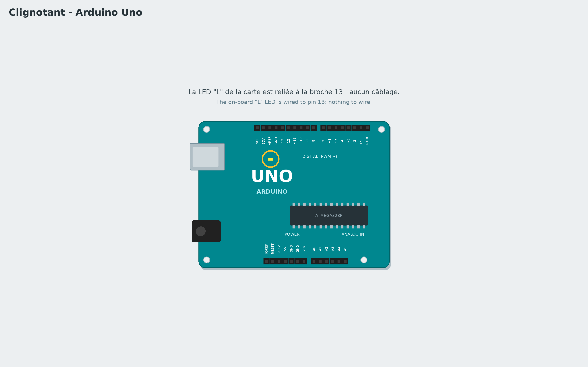

La LED "L" soudée sur la carte clignote : rien à brancher. / The on-board "L" LED blinks: nothing to wire.

## Feu tricolore / Traffic light

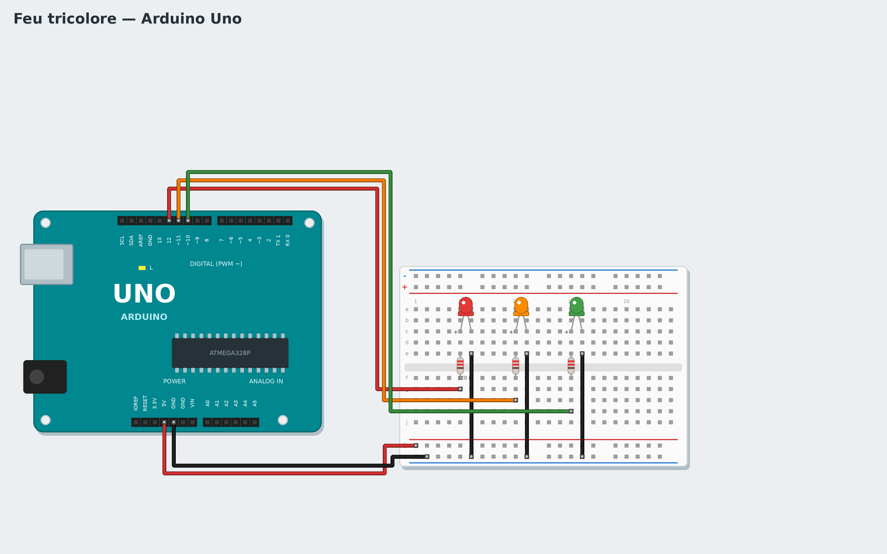

Vert 3 s, orange 1 s, rouge 3 s, sans fin. Chaque couleur est une **fonction** (*feu vert*, *feu orange*,
*feu rouge*) appelée par le script principal. / Green 3 s, orange 1 s, red 3 s, forever. Each colour is a
**function** called by the main script.

| Composant / Part | Broche / Pin |
|---|---|
| LED rouge / red, par une résistance de 220 Ω / through a 220 Ω resistor | 12 |
| LED orange, par une résistance de 220 Ω | 11 |
| LED verte / green, par une résistance de 220 Ω | 10 |
| Patte courte (−) de chaque LED / short (−) leg of each LED | GND |

## Bouton et LED / Button and LED

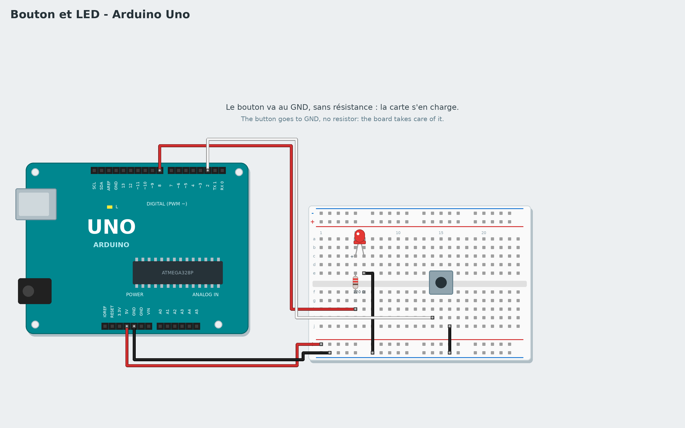

La LED s'allume tant que le bouton est appuyé. Le bouton va d'un côté sur la broche 2, de l'autre au GND,
**sans résistance** : le bloc "le bouton de la broche ... est appuyé" active la résistance de tirage
intégrée à la carte. / The LED is on while the button is held down. One side of the button goes to pin 2,
the other to GND, **no resistor**: the block "button of pin ... is pressed" switches on the board's built-in
pull-up resistor.

| Composant / Part | Broche / Pin |
|---|---|
| LED, par une résistance de 220 Ω / through a 220 Ω resistor | 8 |
| Patte courte (−) de la LED / short (−) leg of the LED | GND |
| Bouton, un côté / button, one side | 2 |
| Bouton, autre côté / button, other side | GND |

## Joystick et LED / Joystick and LEDs

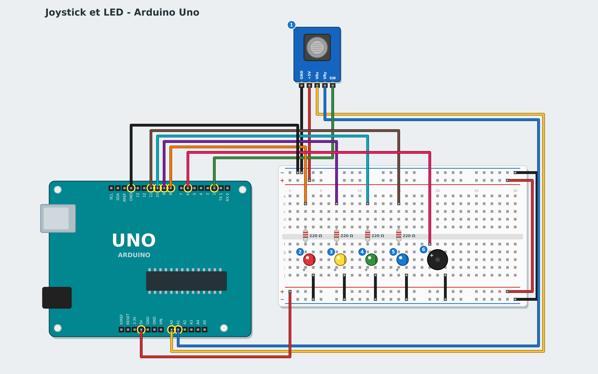

Pousse le joystick : la LED de cette direction s'allume (haut 8, bas 9, gauche 10, droite 11). Appuie dessus :
le buzzer bipe. Si haut et bas sont inversés, tourne le joystick d'un demi-tour. / Push the joystick: the LED
of that direction lights up (up 8, down 9, left 10, right 11). Press it down: the buzzer beeps. If up and down
are the wrong way round, turn the joystick half a turn.

| Composant / Part | Broche / Pin |
|---|---|
| Joystick : GND / +5V | GND / 5V |
| Joystick : VRx / VRy | A0 / A1 |
| Joystick : SW (sans résistance / no resistor) | 2 |
| 4 LED, chacune par une résistance de 220 Ω / each through a 220 Ω resistor | 8, 9, 10, 11 |
| Buzzer passif / passive buzzer (+) | 6 |

## Potentiomètre et servomoteur / Potentiometer and servo

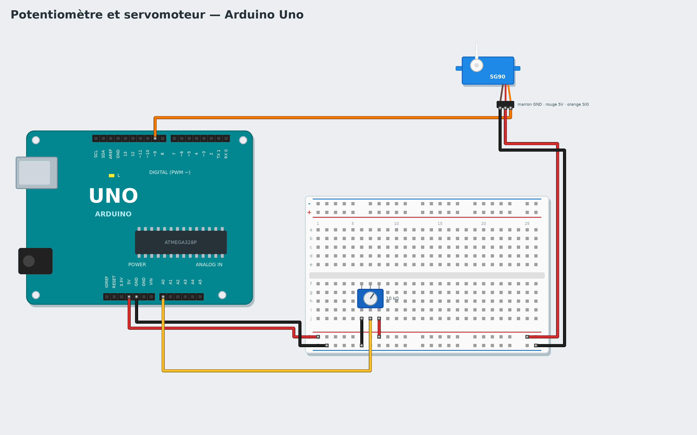

Tourner le potentiomètre fait tourner le bras du servomoteur de 0 à 180°.
Turning the knob moves the servo arm from 0 to 180°.

| Composant / Part | Broche / Pin |
|---|---|
| Potentiomètre 10 kΩ : pattes extérieures / outer legs | GND et 5V |
| Potentiomètre : patte du milieu / middle leg | A0 |
| Servo SG90 : marron / brown | GND |
| Servo : rouge / red | 5V |
| Servo : orange | 9 |

## Alarme de distance / Distance alarm

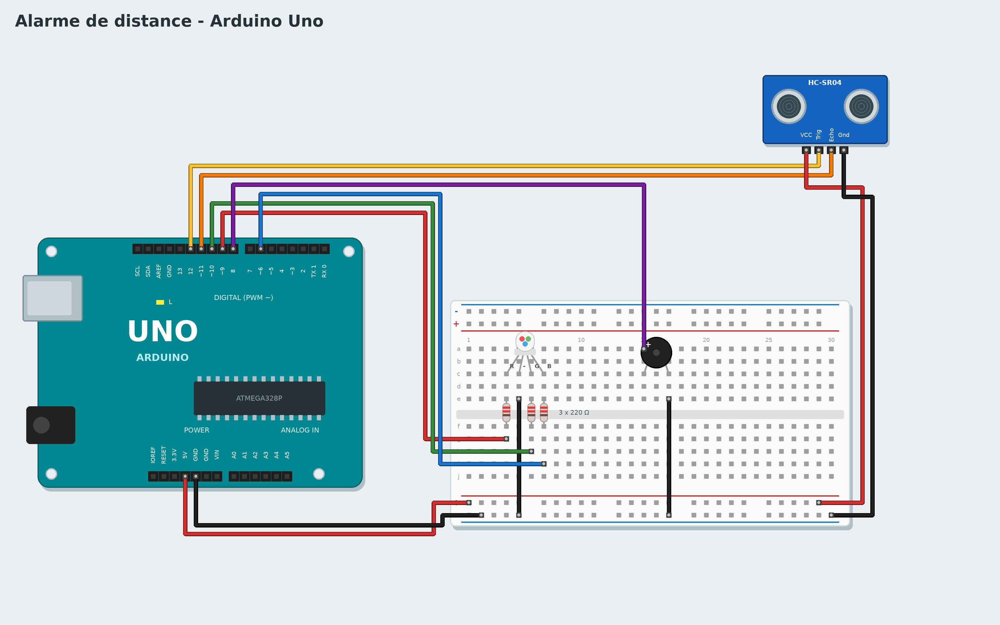

La LED est verte quand rien n'est proche ; à moins de 20 cm elle devient rouge et le buzzer bipe de plus
en plus vite. / The LED is green when nothing is near; under 20 cm it turns red and the buzzer beeps
faster and faster.

| Composant / Part | Broche / Pin |
|---|---|
| HC-SR04 : VCC / Gnd | 5V / GND |
| HC-SR04 : Trig / Echo | 12 / 11 |
| LED RGB (cathode commune / common cathode) : R, G, B, chacune par une résistance de 220 Ω / each through a 220 Ω resistor | 9, 10, 6 |
| LED RGB : patte la plus longue / longest leg | GND |
| Buzzer : + / − | 8 / GND |

## Alarme de mouvement / Motion alarm

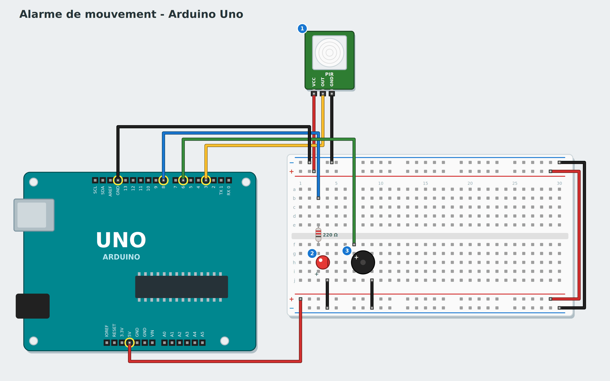

Quand quelqu'un passe devant le capteur PIR, la LED s'allume, le buzzer bipe trois fois et le moniteur série
affiche le nombre de passages. Le capteur met environ une minute à se régler après le branchement. / When
someone walks past the PIR sensor, the LED lights up, the buzzer beeps three times and the serial monitor
shows how many people passed. The sensor takes about a minute to settle after it is powered.

| Composant / Part | Broche / Pin |
|---|---|
| Capteur PIR HC-SR501 : VCC / GND | 5V / GND |
| Capteur PIR : OUT | 3 |
| LED, par une résistance de 220 Ω / through a 220 Ω resistor | 8 |
| Buzzer passif / passive buzzer (+) | 6 |

## Détecteur d'obstacle / Obstacle detector

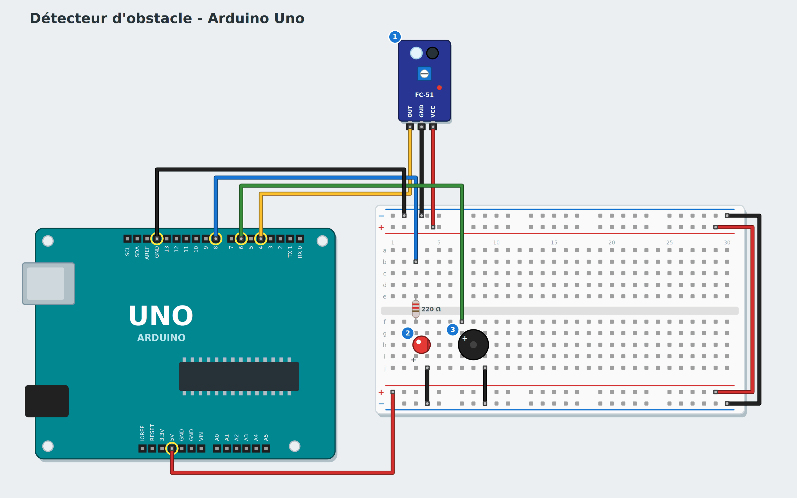

Approche la main du capteur infrarouge : la LED s'allume et le buzzer sonne tant qu'elle est là. La petite vis
bleue règle la distance (quelques centimètres). / Bring your hand close to the infrared sensor: the LED lights
up and the buzzer sounds while it is there. The small blue screw sets the distance (a few centimetres).

| Composant / Part | Broche / Pin |
|---|---|
| Capteur FC-51 : VCC / GND | 5V / GND |
| Capteur FC-51 : OUT | 4 |
| LED, par une résistance de 220 Ω / through a 220 Ω resistor | 8 |
| Buzzer passif / passive buzzer (+) | 6 |

## Thermomètre / Thermometer

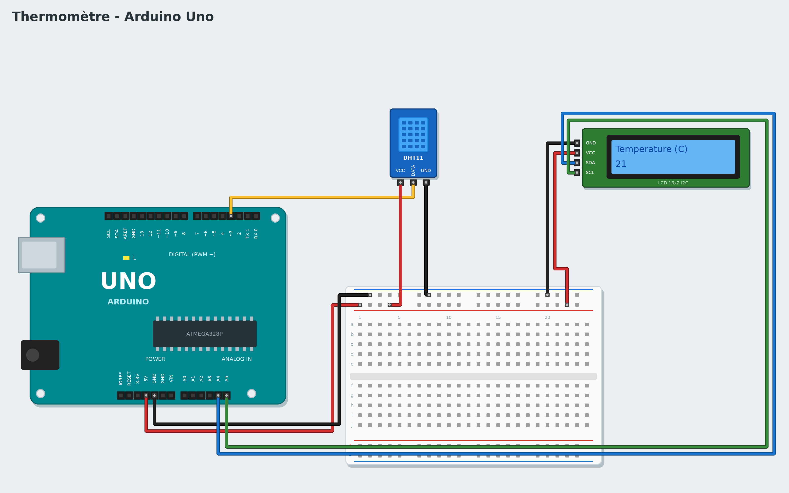

L'écran affiche la température puis l'humidité, toutes les 2 secondes.
The screen shows the temperature, then the humidity, every 2 seconds.

| Composant / Part | Broche / Pin |
|---|---|
| DHT11 : VCC / GND | 5V / GND |
| DHT11 : DATA (out) | 3 |
| LCD 16x2 I2C : GND / VCC | GND / 5V |
| LCD : SDA / SCL | A4 / A5 |

Si l'écran reste vide, tourne la petite vis bleue derrière le module I2C (contraste).
If the screen stays blank, turn the small blue screw behind the I2C module (contrast).

## Thermomètre, écran 16 broches / Thermometer, 16-pin screen

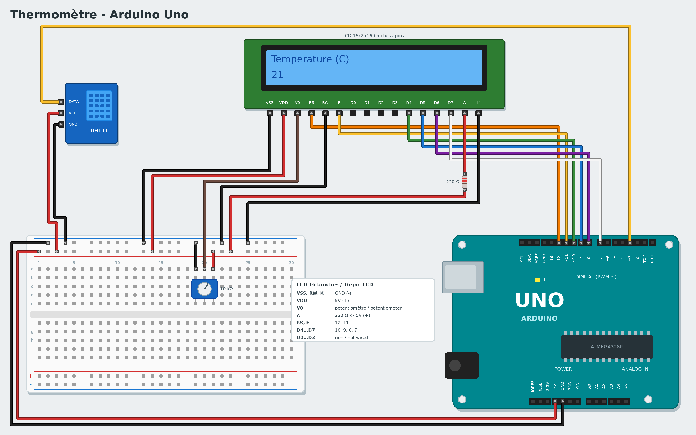

Le même programme avec un écran LCD sans module I2C (16 broches).
The same program with an LCD screen without I2C module (16 pins).

| Composant / Part | Broche / Pin |
|---|---|
| DHT11 : VCC / GND | 5V / GND |
| DHT11 : DATA (out) | 3 |
| LCD : VSS / RW / K | GND |
| LCD : VDD | 5V |
| LCD : V0 | patte du milieu du potentiomètre (les autres sur 5V et GND) / middle leg of the potentiometer (the others to 5V and GND) |
| LCD : A | 5V à travers 220 Ω / 5V through 220 Ω |
| LCD : RS / E | 12 / 11 |
| LCD : D4 / D5 / D6 / D7 | 10 / 9 / 8 / 7 |
| LCD : D0 à D3 / D0 to D3 | rien / not wired |

Si l'écran reste vide ou n'affiche que des carrés, tourne le potentiomètre (contraste).
If the screen stays blank or only shows boxes, turn the potentiometer (contrast).

## Jeu de réaction / Reaction game

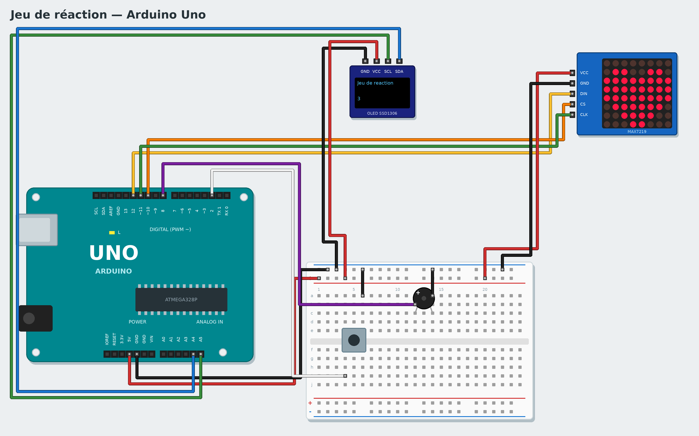

Attends le cœur sur la matrice, puis appuie le plus vite possible : trop tôt, c'est perdu ! Le score
s'affiche sur l'écran OLED. / Wait for the heart on the matrix, then press as fast as you can: too early
and you lose! The score is shown on the OLED screen.

| Composant / Part | Broche / Pin |
|---|---|
| Matrice MAX7219 : VCC / GND | 5V / GND |
| Matrice : DIN / CS / CLK | 12 / 10 / 11 |
| OLED SSD1306 : GND / VCC | GND / 5V |
| OLED : SCL / SDA | A5 / A4 |
| Bouton / Button | 2 et GND |
| Buzzer : + / − | 8 / GND |

Prends un buzzer **passif** (sans autocollant, on voit le circuit dessous) : un buzzer actif grésille.
Si la matrice s'éteint quand le buzzer sonne, ajoute une résistance de 100 Ω en série avec le buzzer.
Si le buzzer bourdonne pendant que la matrice est allumée, branche son − sur un autre GND de l'Arduino que celui de la matrice.
/ Use a **passive** buzzer (no sticker, the circuit board shows underneath): an active one crackles. If the matrix
goes off when the buzzer sounds, add a 100 Ω resistor in series with the buzzer. If the buzzer hums while the
matrix is on, wire its − to another GND pin of the Arduino than the matrix one.

## Jauge lumineuse / Light gauge

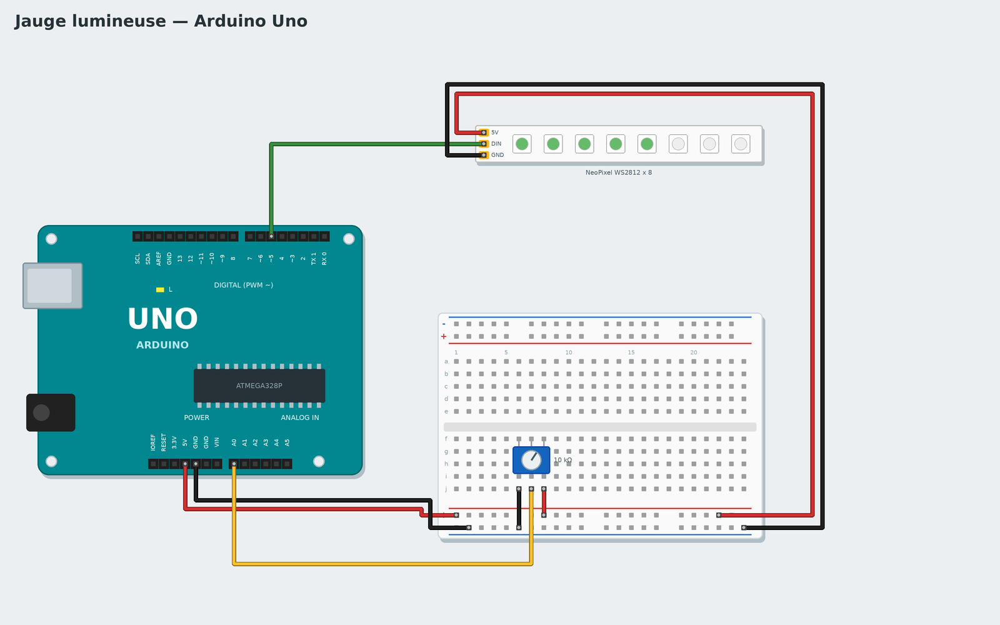

Plus on tourne le potentiomètre, plus il y a de LED allumées sur le ruban.
The more the knob is turned, the more LEDs light up on the strip.

| Composant / Part | Broche / Pin |
|---|---|
| Potentiomètre 10 kΩ : pattes extérieures / outer legs | GND et 5V |
| Potentiomètre : patte du milieu / middle leg | A0 |
| Ruban NeoPixel : 5V / GND | 5V / GND |
| Ruban NeoPixel : DIN | 5 |

## Variateur ESP32 / ESP32 dimmer

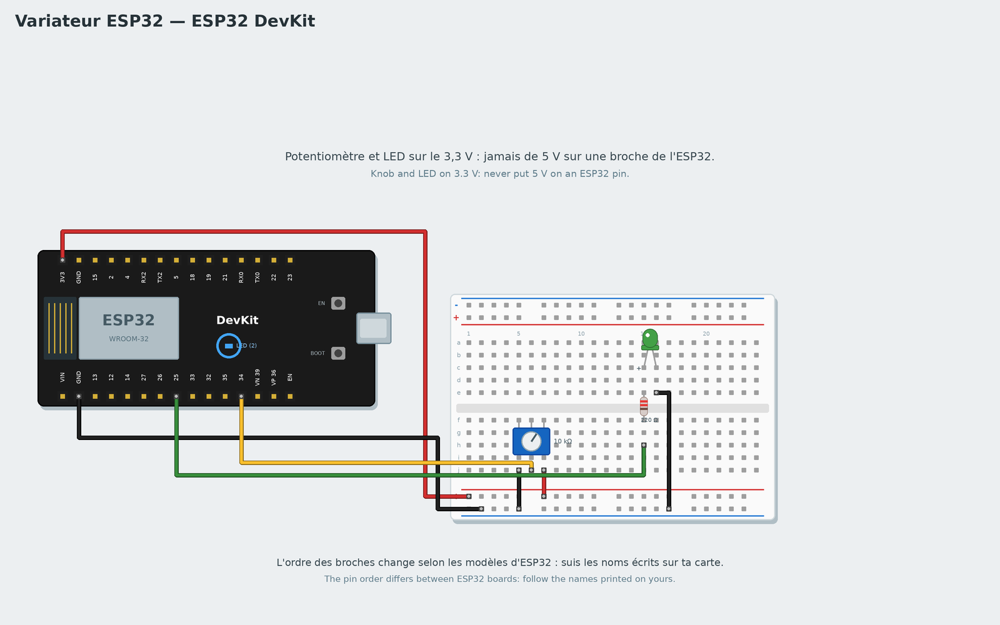

Pour essayer une carte ESP32 (choisir "ESP32 (DevKit)") : la LED bleue de la carte (broche 2) clignote, le
potentiomètre règle la lumière de la LED et sa valeur (0 à 255) s'affiche sur le moniteur série. Les deux
scripts tournent en même temps. Marche aussi en mode Live, par USB ou par Wi-Fi.
To try an ESP32 board (choose "ESP32 (DevKit)"): the blue on-board LED (pin 2) blinks, the knob sets the
brightness of the LED and its value (0 to 255) shows on the serial monitor. Both scripts run at the same time.
Also works in Live mode, over USB or Wi-Fi.

| Composant / Part | Broche / Pin |
|---|---|
| Potentiomètre 10 kΩ : pattes extérieures / outer legs | GND et **3V3** (pas 5V / not 5V) |
| Potentiomètre : patte du milieu / middle leg | 34 |
| LED : patte + (longue) par une résistance de 220 Ω / + leg (long) through a 220 Ω resistor | 25 |
| LED : patte − / − leg | GND |

Les broches de l'ESP32 supportent 3,3 V au plus : ne jamais y mettre de 5 V. L'ordre des broches change selon
les modèles de cartes : suivre les noms écrits sur la carte.
ESP32 pins take 3.3 V at most: never put 5 V on them. The pin order differs between boards: follow the names
printed on yours.

## Station météo sans fil / Wireless weather station

| Par Wi-Fi / Over Wi-Fi | Par Bluetooth / Over Bluetooth |
|---|---|
| 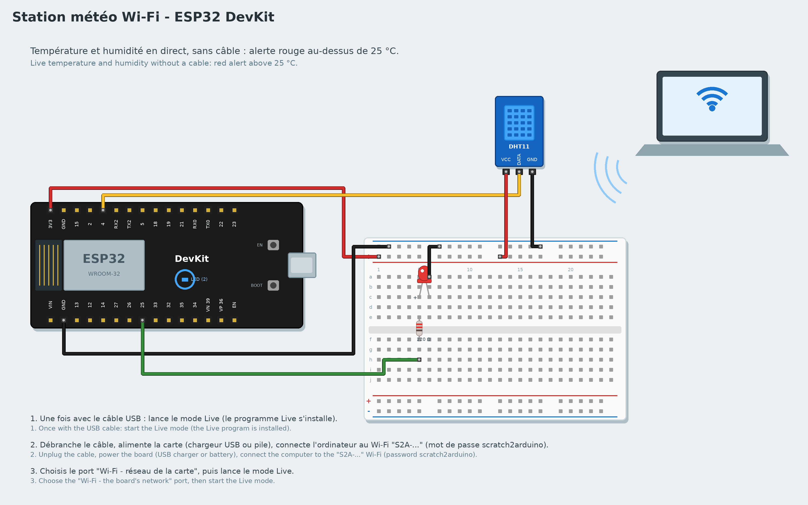 | 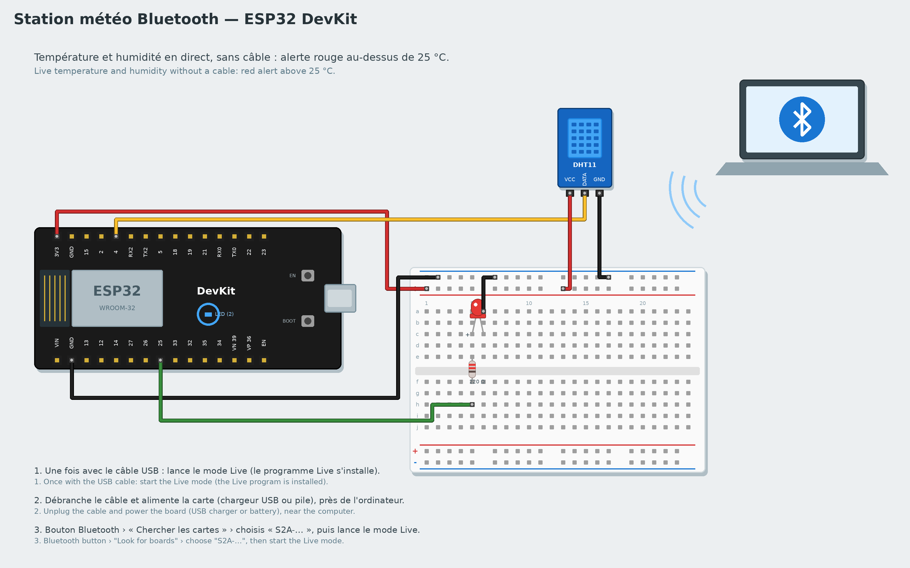 |

La carte ESP32 mesure la température et l'humidité, loin de l'ordinateur et sans câble. En mode Live, les
valeurs s'affichent en direct et une LED rouge s'allume au-dessus de 25 °C. Le programme est le même ;
seule la façon de joindre la carte change (les étapes sont sur chaque schéma).
The ESP32 board measures temperature and humidity, away from the computer and without a cable. In Live mode
the values show live and a red LED lights up above 25 °C. The program is the same; only the way to reach the
board changes (the steps are on each diagram).

| Composant / Part | Broche / Pin |
|---|---|
| DHT11 : VCC / GND | **3V3** / GND |
| DHT11 : DATA | 4 |
| LED : patte + par une résistance de 220 Ω / + leg through a 220 Ω resistor | 25 |
| LED : patte − / − leg | GND |

## Lampe pilotée par téléphone / Phone-controlled lamp

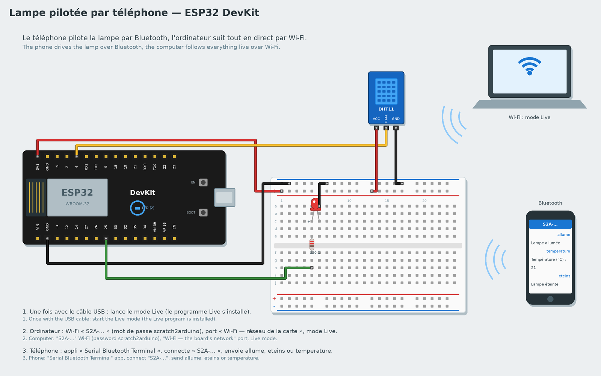

Wi-Fi et Bluetooth ensemble. Sur le téléphone, une appli de terminal Bluetooth (par exemple "Serial
Bluetooth Terminal" sur Android) se connecte à la carte "S2A-..." et envoie `allume`, `eteins` ou
`temperature` (les majuscules et les accents ne comptent pas) : la carte répond. Pendant ce temps,
l'ordinateur suit la lampe et la température en mode Live par Wi-Fi, et peut changer les blocs.
Téléversé, le programme marche aussi avec le téléphone seul. Le mode Live par Bluetooth n'est pas possible
avec les blocs Téléphone : la carte n'a qu'une connexion Bluetooth, prise par le téléphone.
Wi-Fi and Bluetooth together. On the phone, a Bluetooth terminal app (for example "Serial Bluetooth
Terminal" on Android) connects to the "S2A-..." board and sends `allume`, `eteins` or `temperature` (capital
letters and accents do not matter): the board answers. Meanwhile the computer follows the lamp and the
temperature in Live mode over Wi-Fi, and can change the blocks. Uploaded, the program also works with the
phone alone. Live mode over Bluetooth is not possible with the Phone blocks: the board has one Bluetooth
connection, taken by the phone.

Câblage : le même que la station météo sans fil (DHT11 sur 4, LED sur 25, alimentés en 3V3).
Wiring: the same as the wireless weather station (DHT11 on 4, LED on 25, powered from 3V3).

## Robot télécommandé / Remote robot

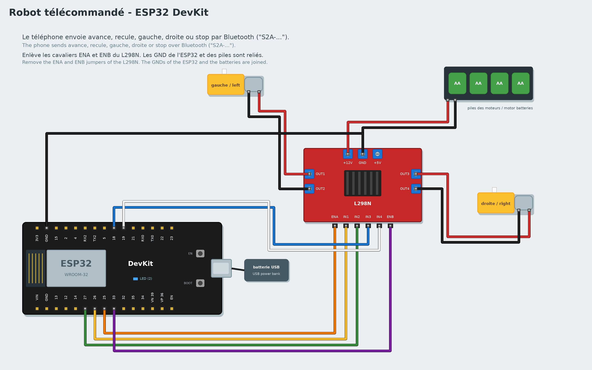

Deux moteurs, pilotés depuis un téléphone par Bluetooth. Téléverse le programme sur l'ESP32, débranche le
câble USB et alimente la carte par une batterie USB. Sur le téléphone, une appli de terminal Bluetooth
(par exemple "Serial Bluetooth Terminal" sur Android, dont les boutons M1 à M5 peuvent recevoir les mots)
se connecte à "S2A-..." et envoie `avance`, `recule`, `gauche`, `droite` ou `stop` : le robot bouge et
répond "ok : ...". Chaque mouvement est une **fonction** (*avancer*, *reculer*, *tourner à gauche*,
*tourner à droite*, *arrêter*). Si une roue tourne à l'envers, inverse ses deux fils sur le L298N.
Two motors, driven from a phone over Bluetooth. Upload the program to the ESP32, unplug the USB cable and
power the board from a USB power bank. On the phone, a Bluetooth terminal app (for example "Serial
Bluetooth Terminal" on Android, whose M1 to M5 buttons can hold the words) connects to "S2A-..." and sends
`avance`, `recule`, `gauche`, `droite` or `stop`: the robot moves and answers "ok : ...". Each move is a
**function**. If a wheel turns the wrong way, swap its two wires on the L298N.

Un seul L298N commande les deux moteurs : le moteur de gauche utilise ENA, IN1, IN2 (sorties OUT1, OUT2),
celui de droite ENB, IN3, IN4 (sorties OUT3, OUT4) ; dans les blocs, chaque moteur a ses broches EN, IN1,
IN2. Enlève les cavaliers ENA et ENB pour que la vitesse soit réglée par la carte. Les piles alimentent les
moteurs (bornier +12V et GND) ; leur − est relié au GND de l'ESP32, sinon les ordres n'arrivent pas.
One L298N drives both motors: the left one uses ENA, IN1, IN2 (outputs OUT1, OUT2), the right one ENB, IN3,
IN4 (outputs OUT3, OUT4); in the blocks, each motor has its EN, IN1, IN2 pins. Remove the ENA and ENB
jumpers so that the board sets the speed. The batteries feed the motors (+12V and GND terminal); their −
is joined to the GND of the ESP32, otherwise the orders do not get through.

| L298N | ESP32 |
|---|---|
| ENA / IN1 / IN2 (moteur gauche / left motor) | 25 / 26 / 27 |
| ENB / IN3 / IN4 (moteur droit / right motor) | 33 / 18 / 19 |
| GND | GND (et − des piles / and battery −) |

### Variante Uno + module HC-05 / Uno + HC-05 module variant

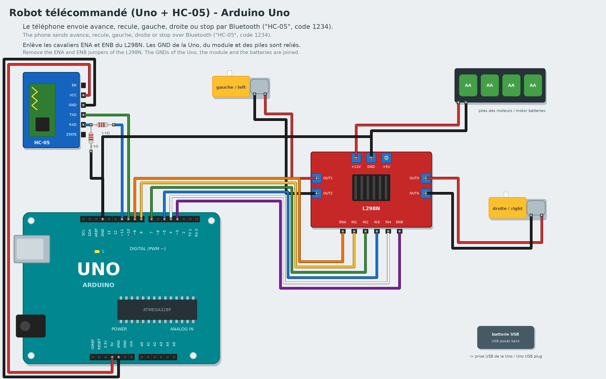

Le même robot avec une Arduino Uno : un module Bluetooth HC-05 (ou HC-06) lui donne le Bluetooth, déclaré
par le bloc *module Bluetooth HC-05 / HC-06* sous "quand le programme démarre". Le téléphone se connecte à
"HC-05" (code 1234 ou 0000). RXD du module n'accepte que 3,3 V : 1 kΩ entre la broche 11 et RXD, 2 kΩ
entre RXD et GND.
The same robot with an Arduino Uno: an HC-05 (or HC-06) Bluetooth module gives it Bluetooth, declared by
the *HC-05 / HC-06 Bluetooth module* block under "when the program starts". The phone connects to "HC-05"
(code 1234 or 0000). RXD of the module only takes 3.3 V: 1 kΩ between pin 11 and RXD, 2 kΩ between RXD
and GND.

| Uno | L298N / HC-05 |
|---|---|
| 9 / 8 / 7 | ENA / IN1 / IN2 (moteur gauche / left motor) |
| 5 / 4 / 3 | IN3 / IN4 / ENB (moteur droit / right motor) |
| 10 | HC-05 TXD |
| 11 | HC-05 RXD (pont diviseur / voltage divider) |
| 5V / GND | HC-05 VCC / GND, GND du L298N / L298N GND |

---

Les schémas sont dessinés par [`tools/wiring/wiring.py`](../tools/wiring/wiring.py) (Python + Pillow) :
quand un exemple change de broches, mets à jour sa fonction dans ce script puis lance
`python3 tools/wiring/wiring.py <exemple>`.
The diagrams are drawn by [`tools/wiring/wiring.py`](../tools/wiring/wiring.py) (Python + Pillow): when an
example changes its pins, update its function in that script and run `python3 tools/wiring/wiring.py <example>`.
